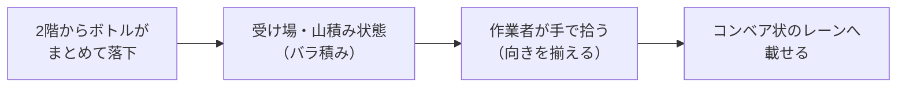

# Task 1：2階から落下するボトルのピック＆プレース自動化

**優先度：高**

## 1. 現状の工程概要

- 2階からボトルがまとめて（どさっと）落ちてくる。
- **ボトルは「空」**であり、**ボトルによって若干形が違う（多品種・形状バラつき）可能性**がある。
- 作業者が手作業でボトルを1本ずつ拾い、コンベアのようなレーンに置く作業を繰り返している。
- この人手作業を協働ロボットアーム（6軸・真空吸引）で自動化したい。

## 2. 技術的な課題分類とポイント

この工程は典型的な **「バラ積みピッキング（Bin Picking）＋ 整列供給（Orientation & Place）」** に該当します。
ソフトウェアチームが最初に知っておくべき現実的な落とし穴は以下の通りです。

### ① 3Dビジョン／カメラ認識の難易度（ボトル特有の罠）
- ボトルが **透明・半透明（PETやガラス）** または **光沢あり** の場合、一般的なデプスカメラ（ステレオ/ToF等）は反射や透過で点群が欠損しやすい。
- ラベルの有無や照明条件によっても認識精度が大きく変わる。

### ② 「どさっと落ちる」物理現象と安全・干渉
- ロボットがピッキングしている最中に2階からボトルが落ちてくると、**アームやカメラに直撃する／ワークが動いて把持ミスする**リスクがある。
- **対策の方向性**：
  - 落下を受けるホッパー・シュートで勢いを殺し、**振動フィーダや傾斜スロープ等で「平面にほぐしてから（1〜2層化）」** アームで拾う（3Dバラ積みより圧倒的に安定・高速）。
  - 具体的なシュート・スロープ・振動加振・ターンテーブル機構の詳細は [chute_and_feeder_mechanisms.md](../04_architecture/chute_and_feeder_mechanisms.md) を参照。

### ③ タクトタイムと協働ロボットの速度限界
- 協働ロボットは安全上、産業用ロボットより動作速度が遅い（特に人が近くにいる設定の場合）。
- 1本あたり何秒で処理する必要があるか（BPM：Bottles Per Minute）によっては、**1台の協働ロボットでは速度が間に合わない**可能性がある。

### ④ そもそも「メカ（機構）で解決できる部分」の切り分け
- もしボトルの形状が1〜数種類で固定なら、ロボットアームではなく **ボトルアンスクランブラー（整列機）やパーツフィーダ** の方が速くて安い場合もある。
- 多品種対応や既存設備との兼ね合いでロボットを使う場合でも、**「取りやすい状態に広げる・向きを大まかに揃える」部分だけ簡易メカに任せる**と成功率が跳ね上がる。

## 3. Task 1 で次に確認すべき項目（Open Questions）

- [x] **中身有無**：空ボトル（軽量・真空吸引と高相性）
- [x] **品種・形状バラつき**：若干形が違う可能性あり（多品種対応しやすいロボット＋吸着が有利）
- [x] **ボトルの色・透明度**：基本は不透明、一部「色付き透明（半透明）」あり
- [x] **堆積状態**：2階からの落下後、山積みになっている可能性が高い
- [ ] **ボトルの仕様詳細**：材質（樹脂・ガラス等）、おおよそのサイズ・重量レンジ
- [ ] **要求タクトタイム**：1分間に何本、あるいは1日に何本処理する必要があるか
- [ ] **2階からの落下条件**：どのくらいの頻度・量で落ちてくるか、現在の受け皿（カゴ・台・ホッパー等）の形状・高さ
- [ ] **コンベアレーンの仕様**：
  - レーンに置くときの**向きの指定**（立てて置く / 寝かせて置く / 口の向きを揃える等）
  - 置くときコンベアは**動いているか（コンベアトラッキング必要か）**、一時停止できるか
  - **コンベアを制御している PLC の有無**（メーカー・型番、予備 I/O や信号をもらえるか）
- [ ] **作業スペース**：2階からの落下口〜コンベアまでの距離・配置図・写真
