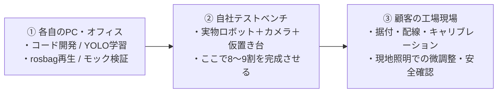

# 開発ワークフロー・環境・ツール・作業場所ガイド

ソフトウェアエンジニア中心のチームが、**「どこで」「何を使って」「どういう手順で」** ロボット・FA システムを開発し、工場へ導入していくかの全体像です。

---

## 1. 作業場所の3段階（すべてを工場でやらない）

ロボット開発で一番やってはいけないのは、**「最初から工場の現場でコードを書こうとすること」**です。工場は騒音・時間制限・ネット制限があるため、以下の3段階で進めます。

1. **① 各自の開発PC（オフィス / リモート）**
   - YOLO の学習・推論コード、ステートマシン、Web UI の実装。
   - テストベンチで録画した `rosbag2`（カメラ映像＋深度データ）を再生すれば、**ロボット実機が目の前になくても**認識と座標計算のデバッグができる。
2. **② 自社オフィス・検証スペース（テストベンチ環境）** ← **最重要**
   - 購入した6軸協働ロボット・カメラ・吸着ユニット・制御PC を仮架台（アルミフレーム等）に組み、段ボールや簡易コンベアで現場を模擬する。
   - **連続数百回〜千回の耐久テストもここで済ませ、8〜9割完成させてから工場へ持ち込む。**
3. **③ 顧客の工場現場（現地立ち上げ）**
   - 架台・制御盤の固定、電源・エア・安全機器の接続。
   - 現地ではゼロからコードを書かず、**「キャリブレーション」「現地照明での画像数枚追加・閾値調整（YAML設定変更）」「連続稼働確認」**に集中する。

---

## 2. 日々の開発ワークフロー

1. **データ収集・アノテーション**
   - 実物ボトルをテストベンチ（または現地）に並べ、RGB-D カメラで多様な角度・重なりを撮影。
   - アノテーションツール（CVAT / Roboflow / Label Studio 等）で「口・底」のキーポイントや領域マスクをラベル付けして YOLO を学習。
2. **実装とオフライン検証（VS Code ＋ Docker）**
   - `robot_wrapper_node` をモックモード（またはシミュレータ/RViz2）に切り替え、`rosbag2` データを流して座標変換と状態遷移を検証。
   - GitHub（PR レビュー）でマージし、Docker イメージをビルド。
3. **実機テスト（必ず「低速＋非常停止」から）**
   - テストベンチ PC へ VS Code Remote-SSH（または Docker pull）で反映。
   - **最初は必ず速度 10〜20% に落とし、片手に非常停止ボタンを持って動かす。**
4. **異常系・連続稼働テスト**
   - 「わざとボトルを落とす」「吸着中に手で引っ張る」「カメラケーブルを抜く」などの意地悪テストを行い、安全に停止・復帰できるか確認。

---

## 3. シミュレーションと実機制御の境界（どこまでやる価値があるか）

ソフト系チームは「全部シミュレータ（Gazebo / Isaac Sim 等）で作ってから実機へ」と考えがちですが、FA では**「やるべき領域」と「実物でやるべき領域」**を明確に分けないと時間を溶かします。

| 検証したいこと | シミュレーションの価値 | 理由とやり方 |
| --- | --- | --- |
| **リーチ・配置・壁との干渉・特異点** | **◎ やる価値大** | メーカー公式 URDF（または無料シミュレータ）にホッパー・コンベアの**直方体（Box）を 3〜4個置くだけ**で、ロボット購入前に「奥まで届くか」「壁に当たらないか」を確認できる |
| **ステートマシン・異常系テスト** | **◎ モックで十分** | `rosbag2` 再生＋仮想 DI/DO モックで状態遷移バグを潰せる |
| **真空吸着・破壊ブロー・ボトルの倒れ方** | **❌ やらない（実物）** | ゴムの張り付き・エア漏れ・空ボトルの跳ね方は物理再現が難しく、実物で試す方が10倍速くて正確 |
| **YOLO 学習用の CG 合成データ生成** | **❌ やらない（実物）** | 今回のように実物ボトルが手に入るなら、実物を 100〜200枚撮って CVAT でラベル付けする方が圧倒的に速く高精度 |

### URDF / SDF と実機制御での割り切り
- **工場環境を SDF で再現する必要はない**：現地でロボット予定地からホッパー・コンベア・壁までの距離をメジャーで実測し、本番コード（SDK ラッパー構成）では **「進入禁止エリア（X/Y/Z 上下限）」と「安全退避高さ `Z_safe`」を YAML に書くだけ** で十分安全に制御できる。
- **URDF は自作しない**：メーカー公式の URDF（または付属シミュレータ）をリーチ確認に借りるだけに留め、物理の詰めはテストベンチの実機で回す。

---

## 4. 開発・現場ツール一式

### ソフトウェア・開発ツール
- **IDE / Git**：VS Code（Remote-SSH / DevContainer）、Git / GitHub（Issues・PR・Actions）
- **コンテナ・OS**：Ubuntu LTS ＋ Docker / Docker Compose
- **ロボティクス・可視化**：ROS 2（`rviz2`, `rosbag2`, `rqt`, `tf2_tools`）
- **AI・アノテーション**：PyTorch / Ultralytics (YOLO) / TensorRT、CVAT または Roboflow

### 電気・メカ・現場工具（ソフト屋でも必須の七つ道具）
- **デジタルマルチメータ（テスター）**：DC24V が来ているか、NPN/PNP や断線の切り分けに必須
- **六角レンチ・精密ドライバー・端子台用マイナスドライバー**：架台・カメラ・24V I/O 配線用
- **圧着ペンチ・フェルール端子・タイラップ（結束バンド）**：配線の抜け・振動対策
- **ラベルライター（テプラ等）**：LAN・USB・24V配線すべてに番号札を貼る（これがないと現場で詰む）
- **メジャー・水平器・ArUco キャリブレーションボード**
- **予備品**：予備の吸着パッド、予備 LAN/USB ケーブル、オフライン用 USB メモリ（Docker イメージ持ち込み用）
