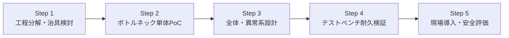

# FA（工場自動化）導入ロードマップ

ソフトウェア中心のチームが、手戻りを最小限に抑えてロボット自動化を立ち上げるための標準プロセスです。

## Step 1：工程分解と「治具・前後工程」の整理
- 「ロボットが動く部分」だけでなく、**ワークの供給・排出・位置決め**まで含めて工程を分解する。
- 認識や制御を複雑にする前に、**シンプルな治具・ガイド・メカ工夫で難易度を下げられないか**を最優先で検討する。

## Step 2：ボトルネック単体の PoC（要素検証）
- いきなり全体システムを作らず、**最も失敗リスクが高い箇所だけ**を先に実機で検証する。
  - 把持テスト（グリッパ／吸着で安定して持てるか、滑らないか）
  - 認識テスト（現場に近い照明・ワーク状態で認識精度が出るか）
  - サイクルタイム試算（目標タクトに間に合うか）

## Step 3：全体アーキテクチャと異常系設計
- ハードウェア選定（アーム、エンドエフェクタ、カメラ、PLC、安全機器）を確定する。
- 正常系より先に**異常系・復旧フロー**を設計する。
  - 非常停止、把持失敗、二重取り、通信断、停電後の原点復帰・安全再開手順

## Step 4：テストベンチでの統合・耐久検証
- 「数回動く」ではなく、**数百〜数千回の連続稼働テスト**で熱・ズレ・稀なエラーを洗い出す。
- エラー発生時のログ取得と、現場作業者でも戻せるリカバリー手順を検証する。

## Step 5：現場導入・リスクアセスメント・運用定着
- 現地据付・キャリブレーション・微調整。
- リスクアセスメントの実施と安全対策の最終確認。
- 操作マニュアル・日常点検項目・保守体制の引き継ぎ。

---

## 開発期間の現実的な目安（5人ソフトチーム＋師匠体制）

| マイルストーン | 所要期間（実機到着後） | 達成状態の目安 |
| --- | --- | --- |
| **① 机上 PoC 動作** | **2〜4週間** | 自社オフィスで空ボトルを数本〜10本連続で拾って置ける |
| **② テストベンチ完成** | **＋1〜1.5ヶ月** | Docker / ステートマシン / 異常復旧込みで数百回連続稼働できる |
| **③ 工場本番稼働** | **＋1〜2ヶ月** | 制御盤・架台（外注納期含む）・現地照明調整・安全評価を経て現場稼働 |

- **トータル目安**：**実機発注から工場本番稼働まで 約3〜4.5ヶ月**（※ロボット本体や制御盤の**手配・製作納期に1〜1.5ヶ月**かかるため、ソフト開発と並行して早めに発注を進めるのがコツ）。
