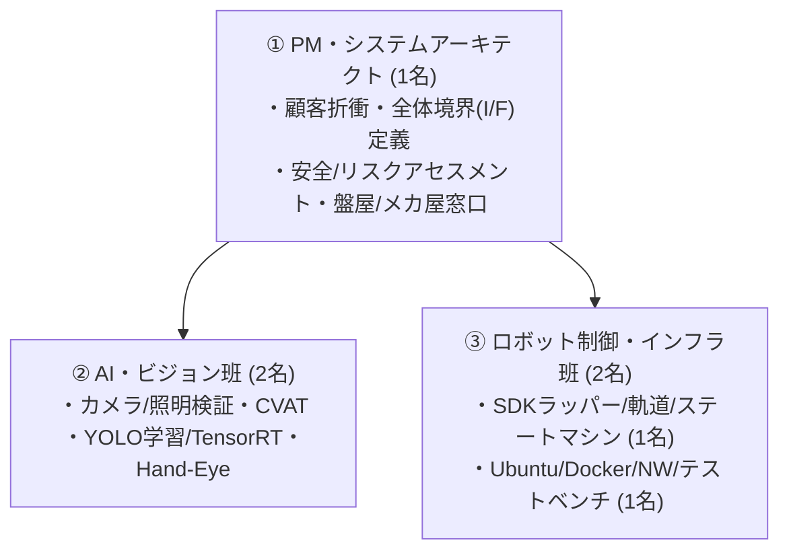

# 戦い方・チーム編成・パートナー戦略（5人前後のソフト系スタートアップ向け）

ロボット未経験のソフトウェア系スタートアップ（5人前後）が、既存のロボット SIer と正面衝突せずに案件をやり切り、事業として勝ち筋を作るための戦略・チーム編成ガイドです。

---

## 1. どう戦うか（従来型 SIer との差別化ポイント）

| 比較軸 | 従来型ロボット SIer の土俵（戦わない） | ソフト系スタートアップの勝ち筋（ここを狙う） |
| --- | --- | --- |
| **対象ワーク** | 単一品種・完全に位置決めされたワーク | **若干形状が違う・バラ積みなど、従来ビジョンで難しいワーク** |
| **技術コア** | PLC ラダー ＋ 既製スマートカメラ ＋ 専用治具 | **AI（YOLO-pose/seg）＋ 3D認識 ＋ 柔軟な上位ソフト** |
| **導入スタイル** | 大規模ライン一式・既存PLC大改造・高額案件 | **後付け協働ロボットで既存ラインを触らずスモールスタート** |
| **保守・運用** | 電話対応＋現地出張が基本 | **エラー画像自動保存 ＋ VPN 遠隔監視 ＋ Docker 即時復旧** |

---

## 2. 自社で握る領域 vs 外部パートナーに任せる領域

すべてを自社でやろうとせず、**「強みが出るソフト・AIは自社、物理の安全・盤・板金はプロに頼む」** 線引きが生命線です。

- **自社で握る（コア技術）**：
  - カメラ選定・照明調整・AIモデル（YOLO）学習と推論最適化
  - 座標変換（Hand-Eye）・ロボット制御ロジック・異常系ステートマシン
  - Linux / Docker / 保守基盤（エラー画像保存・Web UI・遠隔監視）
- **外部パートナー・既製品に任せる（外注／標準品）**：
  - **制御盤・100V/200V電気配線・安全リレー**：地元の**制御盤製作会社（電装屋・盤屋）**に仕様書（機器リスト・I/O表）を渡して組んでもらう
  - **架台・ホッパー・簡易治具**：ミスミ等の**アルミフレーム既製品**や地元の板金・加工屋を活用する

---

## 3. 5人チームの具体的なチーム分け・編成

| チーム・担当 | 人数 | 主なミッション |
| --- | --- | --- |
| **① PM・アーキテクト（橋渡し役）** | 1名 | 顧客ヒアリング、全体の境界仕様（24V I/O・座標系・状態遷移）の決定、盤屋・メカ屋との調整、安全評価。**全員の作業が繋がる絵を描く役割** |
| **② AI・ビジョン班** | 2名 | 実物撮影、CVAT でのラベル付け、YOLO-pose/seg 学習・TensorRT 化、Depth 欠損対策、Hand-Eye キャリブレーション |
| **③ ロボット制御担当** | 1名 | ロボット SDK ラッパー、軌道設計（MoveJ/MoveL）、吸着I/O（DI/DO）、異常リトライ・安全退避ロジック |
| **③ インフラ・現場担当** | 1名 | Ubuntu / Docker / ネットワーク分離・VPN 構築、テストベンチ組み立て、エラー画像自動保存・Web UI |

> **チーム運営のコツ**：全員が全領域を実装できる必要はありませんが、[`00_essential_curriculum.md`](../03_robotics_handbook/00_essential_curriculum.md) を共通言語として共有し、**週1回はテストベンチ（実機）の前に全員で集まって「物理の動き」を見る**と認識ズレがなくなります。

---

## 4. 最初から「本番フルスペック」を作らない段階戦略

| フェーズ | やること | やらなくていいこと（後回し） |
| --- | --- | --- |
| **Phase A：机上 PoC（目標 2〜4週間）** | ・手持ちの Ubuntu PC ＋ **Python SDK 直叩き** ・**USB3 カメラ**＋実物ボトル撮影＆YOLO検証 ・真空パッドで10本拾って並べる成功体験を作る | ・ROS 2 / Docker 化 ・産業用IPC / PoE カメラ / LTE 保守 ・制御盤製作 / 本番安全柵 |
| **Phase B：テストベンチ耐久** | ・**ROS 2（上側のみ）＋ Docker Compose** 化 ・連続数百回のピック＆プレース検証・異常復旧実装 | ・工場現地でのコード開発 |
| **Phase C：工場本番納品** | ・産業用IPC・PoEカメラ・制御盤（外注）・安全回路の統合 ・現地据付・キャリブレーション・リスクアセスメント | ・現地でのゼロからの機能追加 |
