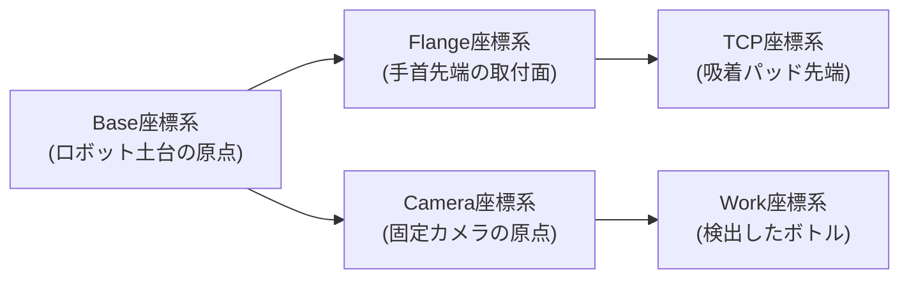

# 01. 座標系（TF）とキャリブレーション

ソフトウェアエンジニアがロボット開発に入るとき、最初に押さえるべき概念が **座標系（Frame / TF）** と **キャリブレーション** です。

## 1. ロボット開発で登場する5つの座標系

- **Base 座標系（World / Base）**：ロボットの土台中心を `(0, 0, 0)` とする絶対基準。すべての移動指令は原則ここ基準で考える。
- **Flange 座標系（Tool0）**：ロボット手首の取り付け面。エンドエフェクタを付け替える前の基準。
- **TCP（Tool Center Point）**：実際にワークへ触れる点（**Task 1 では真空吸着パッドの先端中心**）。コントローラに TCP オフセットを登録しておくと、手首を傾けても「吸着パッド先端が動かない回転」ができる。
- **Camera 座標系**：カメラレンズを原点とした座標系。AI（YOLO）やデプスカメラが出す座標はすべてここ基準。
- **Work 座標系（または Place 座標系）**：ボトルやコンベアの置き場。

## 2. 姿勢の表現（オイラー角 vs クォータニオン）
- 3次元空間の位置・姿勢は **6自由度 `(X, Y, Z, Rx, Ry, Rz)`** で表す。
- メーカーSDKの多くは **オイラー角（またはRPY角：Roll, Pitch, Yaw）** を採用しているが、角度の適用順（XYZ順かZYX順か）や単位（度 `deg` かラジアン `rad` か）がメーカーごとに異なるため要注意。
- ROS 2 / TF 内部ではジンバルロックを防ぐため **クォータニオン `(x, y, z, w)`** を使うのが標準。

## 3. なぜ「カメラの座標」をそのままロボットに送れないのか？
YOLO が画像上で「ボトルは `(u=320px, v=240px)`、深さ `z=0.85m`」と出力しても、それは **Camera 座標系** の値であり、ロボットの **Base 座標系** とは位置も傾きもズレています。

### 必要な変換（Hand-Eye キャリブレーション）
1. **カメラ内部パラメータ（Intrinsics）**：ピクセル `(u, v)` と深度 `Z` から、カメラ基準の 3D 座標 `(Xc, Yc, Zc)` を計算する（OpenCV / RealSense SDK 等で取得）。
2. **外部パラメータ（Extrinsics：`${}^{Base}T_{Camera}$`）**：チェッカーボードや ArUco マーカを使って、カメラとロボット Base 間の変換行列を求める。
3. **座標変換**：
   `P_base = T_base_cam * P_cam`

> **現場運用のコツ**：工場では掃除や振動でカメラが数ミリ動くことがあるため、**キャリブレーション用マーカを置くだけで再計算できるスクリプト**を最初から用意しておくと運用が劇的に楽になります。
