# 02. 運動学と軌道計画（MoveJ / MoveL・特異点）

## 1. FK（順運動学）と IK（逆運動学）
- **FK（Forward Kinematics）**：各関節の角度 `J1〜J6` から、手先（TCP）の位置・姿勢 `(X, Y, Z, Rx, Ry, Rz)` を求める。答えは常に1つ。
- **IK（Inverse Kinematics）**：目標の手先位置・姿勢から、各関節の角度 `J1〜J6` を逆算する。
  - **解が複数ある**（肘を上にするか下にするか、手首を返すか等）。
  - **解けない姿勢がある**（リーチ外、関節リミット超過）。

## 2. PTP（MoveJ）と 直線補間（MoveL）の使い分け
ロボットへの移動指令には主に2種類があり、使い分けが非常に重要です。

| 指令 | 動き方 | メリット | デメリット・注意点 |
| --- | --- | --- | --- |
| **MoveJ（PTP / 関節補間）** | 各関節が同時に最短時間で目標角度へ動く（手先は円弧を描く） | 高速・**特異点を通過しやすい** | 手先の軌道が直線ではないため、周囲の壁やボトルと干渉しやすい |
| **MoveL（LIN / 直線補間）** | 手先（TCP）が空間を一直線に動く | ワークの真上から降りる・真上に引き抜く動作に必須 | **特異点付近で速度暴走・エラー停止しやすい** |

### Task 1 での標準的なピック＆プレース軌道（法線アプローチ＋転倒防止リリース）

```mermaid
flowchart LR
    P1["① 撮影クリア位置<br/>(カメラ視界外)"] -->|"MoveJ"| P2["② 法線上空 Pre-Grasp<br/>(法線方向+80~100mm)"]
    P2 -->|"MoveL (低速)"| P3["③ 吸着 Grasp<br/>(吸着ON・真空確認)"]
    P3 -->|"MoveL"| P4["④ 引き抜き Post-Grasp<br/>(真上/法線+100mm)"]
    P4 -->|"MoveJ (姿勢揃え)"| P5["⑤ コンベア上空 Pre-Place<br/>(Z_safe・向き確定)"]
    P5 -->|"MoveL"| P6["⑥ 置き位置 Place<br/>(底面0~2mmで微少ブロー)"]
    P6 -->|"MoveL (横へ20~30mm)"| P7["⑦ 横逃げ Retract<br/>(転倒防止・上空へ)"]
```

1. **①→② 待機 → 法線アプローチ開始点（`MoveJ`）**：ボトルの法線ベクトル $\vec{n}$ 方向に `80〜100mm` 手前へ高速移動し、手首の角度を合わせる。
2. **②→③ 吸着位置へ降下（`MoveL`）**：法線に沿ってまっすぐ降下し、吸着 ON → 真空圧力スイッチで吸着確定。
3. **③→④ 山から引き抜き（`MoveL`）**：まず法線または真上へ `100mm` まっすぐ引き抜き、隣のボトルへの引っ掛かりを防ぐ。
4. **④→⑤ コンベア上空へ移動＋向き揃え（`MoveJ`）**：安全高さ `Z_safe` を保ちつつ、コンベアに置く向き（立て／寝かせ・口方向）へ手首を回転させる。
5. **⑤→⑥ 置き位置へ降下（`MoveL`）**：底面がコンベアに触れるギリギリ（`0〜2mm`）まで降ろして、吸着 OFF ＋ 微少破壊ブロー（50〜150ms）＋ 50ms 待機。
6. **⑥→⑦ 横逃げ退避（`MoveL`）**：立てて置いた場合はすぐ真上に上げず、パッド吸着面から垂直方向（真横へ `20〜30mm`）に離してから上空へ退避する。

### 軌道を速く・安定させる3つのプロの工夫
- **ブレンディング（Blend Radius）の活用**：経由点（②・④・⑤）で毎回速度ゼロまで完全停止させず、通過半径 `20〜50mm` で滑らかに繋ぐと 1サイクルが大幅に短縮され、揺れも減る。
- **撮影と動作のオーバーラップ**：アームがコンベア側（⑤〜⑦）にいる＝ホッパー上空から手が抜けている瞬間に次フレームの撮影・YOLO推論を完了させておくと待ち時間がゼロになる。
- **J6（手首回転軸）のリミット巻き込み防止**：ボトルの向きを揃えるときに毎回同じ方向に回転して関節リミット（±360°）に当たらないよう、常に最短回転角（±180°以内）を選ぶ。

## 3. 6軸ロボットの罠「特異点（Singularity）」
- 手首の軸（J4とJ6）が一直線に並ぶ姿勢や、肘が伸び切る付近では、手先を少し動かすだけで関節を無限大の速さで回す必要が生じ、**エラー停止や急加速**が起きます。
- **対策**：
  - ロボットの真上や土台の直近（特異点になりやすい領域）に作業エリアを置かない。
  - 移動の大部分は `MoveJ` を使い、`MoveL` は「アプローチと引き抜きの短い区間」だけに限定する。
