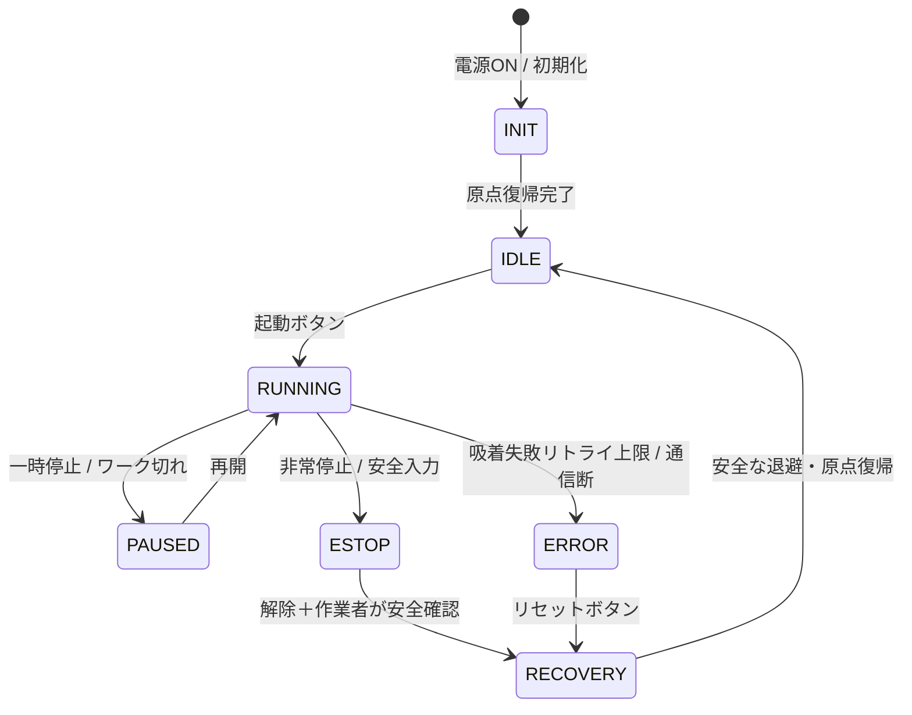

# 03. 安全設計・異常系・ステートマシン

FA（工場自動化）では、**「正常に動くこと」以上に「安全に止まり、現場の人が復旧できること」** が重視されます。

## 1. 協働ロボットの誤解：「協働＝安全柵が絶対不要」ではない
- 協働ロボットは力覚センサ等で衝突時に停止する機能を持ちますが、**「先端に尖った治具を付けている」「高速で動かしている」「ワークが飛ぶリスクがある」** 場合は安全ではありません。
- 工場導入時は **リスクアセスメント**（危険源の洗い出しと速度・力制限の設定）を行い、必要に応じて**安全エリアスキャナ（人が近づいたら減速・停止）や簡易カバー**を組み合わせます。

## 2. 「ソフト停止」と「ハード安全回路」の違い
- ❌ **NG**：非常停止ボタンを PC の USB や通常の入力に繋ぎ、`if button_pressed: robot.stop()` とコードで止める。
  - PCがフリーズしたりバグがあったりすると止まらない。
- ⭕ **OK**：非常停止スイッチ・安全柵・ライトカーテンは、**ロボットコントローラ専用の安全入力（Safety I/O / STO回路）** にハードウェアで直接配線する。
  - ソフトがどうなろうと電気的にモーター動力が遮断される。

## 3. 現場で止まらないための「ステートマシン設計」
Web/アプリ開発の `try-catch` のように例外を握りつぶしたりプロセスを再起動したりすると、**ワークを掴んだままのアームが予測不能な方向に動いて衝突**します。

### Task 1 で必ず組み込むべき異常系処理
1. **吸着失敗リトライ**：真空スイッチが ON にならなければ、少し上へ退避して再認識・別ボトルを狙う（連続 N 回失敗したらエラー停止して通知）。
2. **落下検知**：コンベアへの移動中に真空スイッチが OFF になったら、途中で落としたと判断して安全停止する。
3. **安全退避（原点復帰）**：起動時やエラー解除時にいきなり最短距離でホームポジションへ `MoveJ` すると周囲にぶつかるため、**「まず現在位置から真上（Z安全高さ）へ退避してからホームへ戻る」**手順にする。
