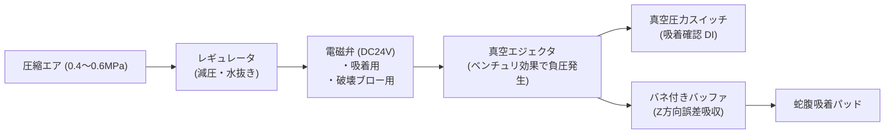
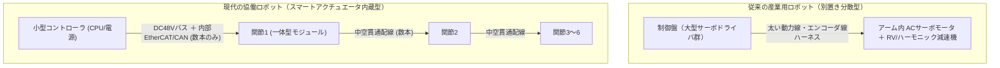
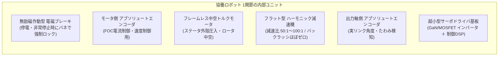

# 04. ハードウェア・空圧（真空吸引）の基礎

## 1. ロボット仕様表で必ず見るべき4つの数値

1. **可搬質量（Payload）と許容モーメント**
   - 「可搬 5kg」は「重心オフセット規定値以内」での値。手首から長いアタッチメントを伸ばすと、1kg しか持てなくなることもある。
   - Task 1 は空ボトル（数十g）＋軽量吸着パッドなので余裕が出やすいが、**カメラや重い電動ポンプを手先に付ける場合は要注意**。
2. **リーチ（Reach）と実効作業範囲**
   - カタログの「リーチ 850mm」は腕を水平にピンと伸ばした最大半径。実際に手首を真下や横に向けてボトルを掴める範囲は **最大リーチの 7〜8割程度** で考える。
3. **繰返し位置決め精度（Repeatability） vs 絶対精度（Absolute Accuracy）**
   - **繰返し位置決め精度（例：±0.03mm）**：ティーチングした同じ点に何度戻ってもズレない精度（非常に高い）。
   - **絶対精度**：カメラから計算した数値座標 `(X=500.0, Y=200.0)` へ一発で行ったときの誤差（ロボットの組立公差やたわみで **数mm ズレる** ことがある）。
   - → だからこそ Hand-Eye キャリブレーションと、メカ的な許容余裕（吸着パッドのバネ等）が重要になる。
4. **IP 保護等級（防塵・防滴）**
   - 工場の粉塵や水・油がある環境なら IP54 / IP65 以上が安心。

## 2. 真空吸引（空圧）の仕組みと4点セット

- **真空エジェクタ**：圧縮エアを流すことで負圧（真空）を作る部品。小型・軽量・安価で応答も速い。
- **真空圧力スイッチ（真空センサ）**：負圧が一定値以下になったら ON になるデジタルセンサ。「ボトルを確実に吸えたか」をソフト側で判定するために必須。
- **バネ付きバッファ（スプリングプランジャ）**：パッドの根元に入れるバネ機構。高さ認識が数mmズレてもボトルを押し潰さず、ソフトに密着できる。
- **破壊ブロー（真空破壊）**：吸着を切った瞬間、わずかな正圧（エア）を吹き込んでボトルをパッドから素早く離す機能。空ボトルは軽いため、破壊ブローがないとパッドに張り付いて離れないことがある。

---

## 3. アーム内部の仕組み（協働ロボットの関節モジュール構造）

ロボットメーカーの中の人ではないため、**IGBT のスイッチング回路や歯車の設計式まで覚える必要はありません。**
ただし、**「現場で起きるトラブル（振動・衝突・電池切れ・過熱エラー）の原因を理解できるレベル」** で以下の仕組みを知っておくと、ソフト開発や保守で圧倒的に役立ちます。

### 従来の産業用ロボット vs 現代の協働ロボットのアクチュエータ構造

従来の産業用ロボット（ファナックや安川等）と現代の協働ロボット（UR、Dobot、JAKA等）では、**関節の内部構造が根本的に異なります**。

協働ロボットが「外側に配線が出ず、スッキリして美しい」「小型軽量」である理由は、**関節の1つひとつにモータ・減速機・エンコーダ・ブレーキ・ドライバ基板がオールインワンで凝縮されている（スマートアクチュエータ化されている）**からです。

---

### 関節モジュール（Smart Actuator）を構成する5つの核心パーツ

| 要素技術 | 役割と特徴 | 現場・ソフト開発で知っておくべき影響 |
| --- | --- | --- |
| **減速機 （ハーモニックドライブ / 波動歯車）** | モーターの高回転・低トルクを、高トルク・高精度に変換する。 薄型・中空構造でバックラッシが極めて小さいため協働ロボットに標準採用 | ・**壁への強い衝突（衝撃荷重）に弱い**ため、ティーチングや起動時は低速で確認する。 ・安価な機種ほど停止直後に手先がわずかに振動（たわみ）するため、**停止後 50〜100ms の整定待ち**を入れると画像認識や吸着が安定する |
| **フレームレス 中空トルクモータ** | ハウジング外殻にステータ（巻線）を直接圧入し、中心が中空になったブラシレスモータ（Kollmorgen製などが有名） | 中心の中空穴（φ10〜30mm程度）を通して配線を通せるため、**関節が 360度以上回転してもケーブルがねじ切れない** |
| **デュアル・エンコーダ （モータ側 ＋ 出力軸側）** | **なぜ1関節に2つのエンコーダがあるのか？** ① モータ側：高速ベクトル制御用 ② 出力軸側：減速機を通した「真の腕の角度」を計測 | ・ハーモニック減速機の「バネ性（ねじれたわみ）」をソフトウェアで補正し、絶対精度を向上させる。 ・**2つのエンコーダの角度差から外力トルクを推定**できるため、高価なトルクセンサなしでも「人との衝突検知」ができる |
| **電磁ブレーキ （無励磁作動型）** | 通電中はバネに逆らって電磁石でブレーキが開き、停電・非常停止で電気が切れると**自動でバネが噛み合って落下を防ぐ** | 電源OFF時にアームを手で退かしたい場合は「ブレーキ解除ボタン」操作が必要（自重で急に落ちないよう支えながら解除する） |
| **内蔵サーボドライバ基板** | 各関節の内部に、インバータ回路とDSPが一体化された超小型基板が内蔵されている | 各軸が自律して電流・位置ループを回し、内部EtherCAT/CANopenでメインコントローラと1ms周期で同期通信する。**連続過負荷をかけると関節内に熱がこもり過熱エラーが出る** |

---

### なぜ犬型ロボットの「QDD（準ダイレクトドライブ）」ではなく、協働ロボットは「高減速比ハーモニック」なのか？

四足歩行ロボット（Unitree等）は、地面からの激しい着地衝撃を吸収するために減速比 6:1〜10:1 の **QDD（Quasi-Direct Drive）** を多用します。手で押すとスルスル動く高いバックドライバビリティが特徴です。

しかし、**産業用・協働ロボットでは QDD は採用されません**。
- **理由1：静止保持トルクと発熱**
  - ロボットアームは「一定の位置で止まったままボトルを吸う」「重い工具を持ち上げて待機する」時間が長いです。
  - 減速比が小さいQDDで重力に抗して静止保持しようとすると、**モーターに膨大な保持電流を流し続けなければならず、数分でコイルが焼損（または熱停止）**します。
  - ハーモニック（減速比 50〜100:1）であれば、モータ側の必要トルクは 1/50〜1/100 で済むため発熱を極小化できます。
- **理由2：電源OFF時の落下防止**
  - 工場で非常停止や停電が起きた際、QDDだとアームが重力で一瞬で落下して下にある設備や人を破壊します。
  - ハーモニック減速機＋無励磁電磁ブレーキの組み合わせにより、電源断でもミリ単位でその姿勢を物理ロックできます。
