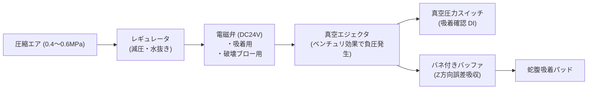

# 04. ハードウェア・空圧（真空吸引）の基礎

## 1. ロボット仕様表で必ず見るべき4つの数値

1. **可搬質量（Payload）と許容モーメント**
   - 「可搬 5kg」は「重心オフセット規定値以内」での値。手首から長いアタッチメントを伸ばすと、1kg しか持てなくなることもある。
   - Task 1 は空ボトル（数十g）＋軽量吸着パッドなので余裕が出やすいが、**カメラや重い電動ポンプを手先に付ける場合は要注意**。
2. **リーチ（Reach）と実効作業範囲**
   - カタログの「リーチ 850mm」は腕を水平にピンと伸ばした最大半径。実際に手首を真下や横に向けてボトルを掴める範囲は **最大リーチの 7〜8割程度** で考える。
3. **繰返し位置決め精度（Repeatability） vs 絶対精度（Absolute Accuracy）**
   - **繰返し位置決め精度（例：±0.03mm）**：ティーチングした同じ点に何度戻ってもズレない精度（非常に高い）。
   - **絶対精度**：カメラから計算した数値座標 `(X=500.0, Y=200.0)` へ一発で行ったときの誤差（ロボットの組立公差やたわみで **数mm ズレる** ことがある）。
   - → だからこそ Hand-Eye キャリブレーションと、メカ的な許容余裕（吸着パッドのバネ等）が重要になる。
4. **IP 保護等級（防塵・防滴）**
   - 工場の粉塵や水・油がある環境なら IP54 / IP65 以上が安心。

## 2. 真空吸引（空圧）の仕組みと4点セット

- **真空エジェクタ**：圧縮エアを流すことで負圧（真空）を作る部品。小型・軽量・安価で応答も速い。
- **真空圧力スイッチ（真空センサ）**：負圧が一定値以下になったら ON になるデジタルセンサ。「ボトルを確実に吸えたか」をソフト側で判定するために必須。
- **バネ付きバッファ（スプリングプランジャ）**：パッドの根元に入れるバネ機構。高さ認識が数mmズレてもボトルを押し潰さず、ソフトに密着できる。
- **破壊ブロー（真空破壊）**：吸着を切った瞬間、わずかな正圧（エア）を吹き込んでボトルをパッドから素早く離す機能。空ボトルは軽いため、破壊ブローがないとパッドに張り付いて離れないことがある。
