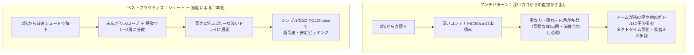
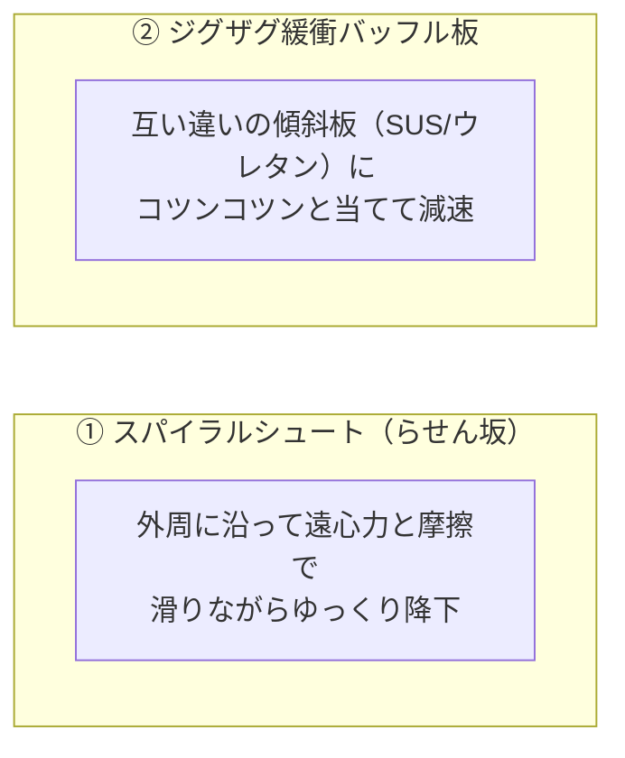
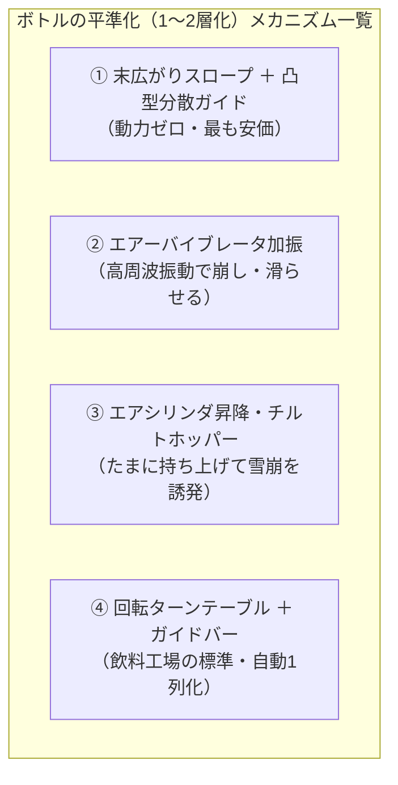
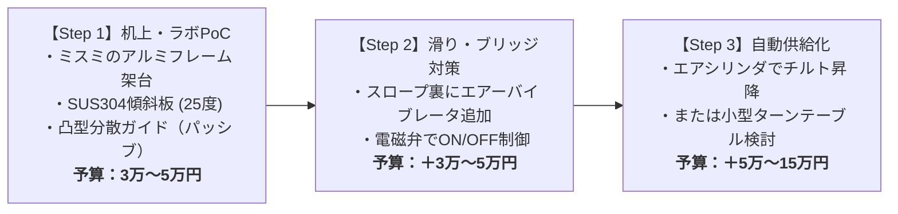

# ボトル供給・投入シュートと平準化（からくり・振動）機構ガイド

2階やホッパーから空ボトルがまとまって投入される場合、**「ロボットアームで深い箱からかき出す」のではなく、「メカ（スロープ・振動・分散板）によって事前に平準化（1〜2層化）する」** のが FA（工場自動化）の鉄則です。

本ドキュメントでは、空ボトルピッキング（Task 1）を成功させるためのシュート設計、減速・分散機構、振動フィーダの活用法をまとめます。

---

## 1. なぜ「メカによる事前平準化」が不可欠なのか？

| 比較項目 | ① 深い箱から直接ピック（非推奨） | ② メカで1〜2層に平準化（推奨） |
| --- | --- | --- |
| **ビジョン・AI** | 高額な産業用3Dカメラ（100万〜200万円）＋ 複雑な点群処理 | 安価な 2D カメラ（数万〜10万円）＋ YOLO-pose |
| **ロボットの動作** | 深い箱の壁を避ける複雑な軌道計画、手首の無理な傾き | 上からスッと降りて吸うだけの最短ストローク |
| **サイクルタイム** | 1本あたり 5〜8秒以上（認識と回避に時間がかかる） | 1本あたり **1.5〜3秒**（高速連続ピック可能） |
| **トラブルリスク** | 箱のフチへの激突、ピッキング時の雪崩・空振り | 衝突リスクほぼゼロ、吸着成功率 98%以上 |

---

## 2. 落下衝撃の緩和・減速機構（2階からの安全な落とし方）

2階から空ボトルをフリーフォール（自由落下）させると、衝突でボトルが凹んだり、跳ね返って割れたり、激しい騒音が発生します。以下の機構で運動エネルギーを減衰させます。

1. **スパイラルシュート（らせんシュート）**：
   - 樹脂製またはステンレス製のらせん状の筒・樋を滑らせる。遠心力で外壁に押し付けられながら滑るため、速度が一定以上上がらず傷もつきにくい。
2. **ジグザグ緩衝バッフル板（板の互い違い配置）**：
   - 角ダクトの中に 30〜45度の傾斜板を左右交互に配置。ボトルが板に当たるたびに運動エネルギーが吸収され、トレイ直前でほぼ静止状態で滑り出る。

---

## 3. 山を崩して広げる「平準化メカニズム」（4選）

### ① 末広がりスロープ ＋ 凸型分散ガイド（完全パッシブ）
- **仕組み**：
  - 投入口は幅狭（例：300mm）、出口に向かってラッパ状に広がる（例：800mm）傾斜板。
  - 中央に **三角形状の樹脂製ガイド（凸型の山）** を設ける。中央に落ちたボトルの山が、左右のスロープへ自然に転がり落ちることで、中心の盛り上がりが解消される。
- **板の材質と傾斜角**：
  - **傾斜角**：プラスチックボトルの場合、**20度〜30度** が滑り出しの目安（急すぎると雪崩になり、緩すぎると途中で止まる）。
  - **材質**：ステンレス板（SUS304 ヘアライン仕上げ）、または低摩擦樹脂シート（テフロン PTFE、超高分子量ポリエチレン UHMWPE）。

### ② エアーバイブレータによる加振（FAの超定番）
- **仕組み**：
  - ボトル同士が噛み合ってスロープ上で止まってしまう「棚吊り（ブリッジ現象）」を、微小な高周波振動で崩す。
  - スロープの裏側に **エアー式バイブレータ（エクセン EXEN 製など）** をボルト固定する。
- **なぜエアーバイブレータなのか？**：
  - 電気式モーターバイブレータより圧倒的に小型・軽量（数百g〜1kg程度）。
  - 圧縮エア配管（φ6チューブ）を繋ぐだけで動き、発熱しない。
  - ロボットコントローラの 24V 出力（電磁弁）から、**「吸着空振りが起きたら 1秒間だけ加振」「ボトルがなくなったら 2秒加振」** のように自在にシーケンス制御できる。

### ③ エアシリンダ昇降・チルトホッパー（からくり揺動）
- **仕組み**：
  - 投入受部の底板を蝶番（ヒンジ）で固定し、裏側から **SMC製小型エアシリンダ（ストローク 50〜100mm）** で押し上げる。
  - ロボットが「ボトル残数が少なくなった」と画像判定した際、シリンダを ON にして板を 10度ほど傾け、手前のピッキングトレイへ新しいボトルをガラガラと滑り落とす。

### ④ 回転ターンテーブル（アキュムレーション円盤）
- **仕組み**：
  - φ600〜1000mm 程度の水平円盤を低速（毎分 5〜15回転）でモーター回転させる。
  - 円盤の上空に固定ガイドフェンスをらせん状に配置する。
- **効果**：
  - ドカッと落ちてきたボトルが、遠心力とガイドフェンスに沿って外周へ押し出され、**最終的に完璧な「1列・単層（重なりなし）」に整列してコンベア出口へ流れる**。
  - 飲料・調味料・化粧品工場のボトル供給ラインにおける世界標準機。

---

## 4. スタートアップのための段階的導入ロードマップ

最初から高価な自動整列機を作るのではなく、**「安く始めて現場のボトル実挙動を見ながら強化する」** のが鉄則です。

---

## 5. 主要機器・部材の型番・選定目安

| 用途 | 推奨品・メーカー | 仕様目安・型番例 | 調達先 |
| --- | --- | --- | --- |
| **スロープ架台** | ミスミ 40角アルミフレーム | 4040シリーズ、ブラケット、アジャスター足 | ミスミWeb |
| **滑り面** | SUS304 プレート（追加工可） | 厚み 1.5〜2.0mm、2Bまたはヘアライン仕上げ | ミスミWeb |
| **低摩擦シート** | スミフロン（テフロン）粘着テープ | 厚み 0.13〜0.2mm、スロープの当たり面に貼る | モノタロウ / ミスミ |
| **エアーバイブレータ** | **エクセン（EXEN）** ピストンバイブレータ | `EPV18` / `EPV25` または ボールバイブレータ `CH19` | 商社 / モノタロウ |
| **駆動用電磁弁** | SMC 2ポート / 3ポート電磁弁 | `VT307` シリーズ（DC24V、配管 Rc1/8〜1/4） | ミスミ / モノタロウ |
| **チルト昇降シリンダ** | SMC 薄型シリンダ（CQS / CQ2） | チューブ内径 φ25〜32、ストローク 50〜100mm | ミスミ |
