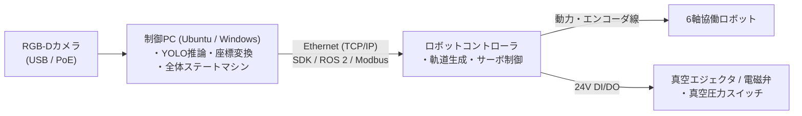

# コントローラ構成とPC接続（100万円前後帯の協働ロボット）

ソフトウェアチームがシステム構成をイメージしやすいよう、100万円前後帯の協働ロボットに付属するコントローラと PC 連携の基本をまとめます。

## 1. 付属するコントローラのイメージ
多くの工場向け協働ロボットでは、アーム本体とは別に **小型デスクトップPC〜薄型AVアンプ程度の専用コントロールボックス** がセットで付属します（一部、台座一体型もあります）。

### コントローラの中身と主なインターフェース
- **内部構成**：電源ユニット、各軸のサーボドライバ、組込み制御CPU（内部で逆運動学・軌道補間・衝突検知を計算）
- **LANポート（Ethernet）**：外部PCやPLCとの通信用（IPアドレスで接続）
- **デジタルI/O（24V DI/DO）**：吸着用の電磁弁ON/OFF、真空スイッチ入力、外部スタート/ストップボタン等
- **安全I/O**：非常停止スイッチ、安全柵・ライトカーテン用の安全入力（※安価帯では安全規格や端子数が簡素な場合があるため事前確認必須）
- **ティーチングペンダント（操作画面）**：
  - 100万円前後帯では **専用ペンダントが別売り（オプション）** で、**手持ちのPCブラウザや専用アプリ（またはタブレット）でGUI操作・ティーチングする機種が多い** です。
  - 工場現場ではPCを常時触らずに済むよう、物理の「起動・停止・非常停止」ボタンを外部I/Oに繋ぐのが定番です。

## 2. PCと接続できるか？
**はい、ほぼすべての機種で PC と接続できます。むしろ 100万円帯は PC（Python/C++/ROS 2）からの制御がしやすい機種が多いです。**

### 接続方式とソフト構成

- **接続方法**：工場環境ではノイズ耐性・配線長の観点から **Ethernet（有線LAN / TCP/IP）** 接続が標準です。
- **制御方法**：
  - **Python / C++ SDK**（メーカー公式）：`move_to(x, y, z, rx, ry, rz)` や `set_do(pin, True)` のようにコードから直接指令可能。
  - **ROS 2 ドライバ**：MoveIt 2 や TF（座標変換）と組み合わせて開発しやすい。
  - **ソケット通信 / Modbus TCP**：シンプルな座標・コマンド送受信だけで完結させたい場合に利用。

## 3. PC接続構成で気をつけるべきポイント（ソフト屋向け）
1. **「PCがフリーズ＝暴走」にしない設計**
   - 非常停止スイッチは PC ではなく**コントローラの安全入力（ハードウェア回路）**に直結させる。
   - PC〜コントローラ間でハートビート（死活監視）やタイムアウト監視を入れる。
2. **リアルタイム制御が必要かどうかの見極め**
   - Task 1 のようなピック＆プレースは「目標座標を送って移動完了を待つ（コマンド型）」で十分動くため、通常の Linux / Windows PC からの Ethernet 通信で問題ない。
   - 動いているコンベアをリアルタイム追従する（コンベアトラッキング）場合は、通信周期やコントローラ側のエンコーダ入力対応が必要になる。
3. **24V I/O と電源の知識**
   - 真空吸引の電磁弁や圧力センサは **DC24V** が標準。PCのUSBやGPIO（3.3V/5V）で直接動かそうとせず、**ロボットコントローラの DI/DO 端子（24V）** 経由で制御・読み取りするのが一番シンプルで安全。

## 4. 制御PCの OS 選定（Linux vs Windows）

**結論：制御PCの OS は Linux（Ubuntu 22.04 LTS または 24.04 LTS）が最適です。**

### Ubuntu Linux を選ぶ理由
- **ROS 2 / カメラSDK / AI推論の標準環境**：ROS 2（MoveIt 2 含む）、RealSense/Orbbec SDK、PyTorch/TensorRT（YOLO）のサポートと事例が最も充実している。
- **工場の長期連続稼働に強い**：Windows Update による意図しない自動再起動を防げる。`systemd` によるサービス自動起動や Docker 化、SSH でのリモート保守も容易。
- **ソフトチームとの親和性**：Git / Docker / Linux ベースの運用に乗せやすく、開発環境と本番環境の差異を減らせる。

### 注意点（Windows が必要になる場面）
- メーカーによっては**「ロボットの初期設定・安全パラメータ設定・ファームウェア更新ツール」が Windows 専用ソフト**の場合がある（ブラウザUIの機種も多い）。
- そのため、**「本番制御PC＝Ubuntu Linux」「現場立ち上げ・保守用ノートPC＝Windows（またはデュアル環境）」**としておくと詰まりにくいです。

### 工場向け制御PCハードウェアの目安
- YOLO 推論をリアルタイム寄りに行う場合は **GPU搭載（NVIDIA RTX系 または Jetson Orin 等）** を検討する。
- 工場環境（粉塵・温度・24時間稼働）に置く本番機は、家庭用PCではなく **産業用PC（IPC）** や耐環境性の高い小型PCを選定するのが望ましい。

## 5. ソフトウェア実行環境（Docker を使うべきか／他の手段）

**結論：ソフトウェアに強いチームであれば、本番運用は「Docker（Docker Compose）」が最もおすすめです。ただしロボティクス特有のハードウェア設定（`network_mode: host` 等）を押さえて使う必要があります。**

| 方式 | メリット | デメリット・注意点 | 向いている場面 |
| --- | --- | --- | --- |
| **Docker / Docker Compose** | ・CUDA / TensorRT / ROS 2 / SDK の依存地獄を防げる ・開発機〜本番機〜予備機への再現性・ロールバックが容易 ・`restart: unless-stopped` で自動復旧しやすい | ・ROS 2 DDS や PoE/USB カメラ用に `network_mode: host` や `/dev/bus/usb` マウントが必要 ・`nvidia-container-toolkit` の設定が必要 | **チーム開発・本番運用・予備機差し替え（推奨）** |
| **ホスト直入れ ＋ `venv`/`uv` ＋ `systemd`** | ・USBカメラやネットワーク、GPUの権限トラブルがゼロで一番シンプル | ・環境構築の手順書や Ansible がないと予備機に同じ環境を作りにくい ・OS/ライブラリ更新で壊れやすい | **初期 PoC で最速で実機を動かしたいとき** |
| **パッケージ管理（`.deb` / `pixi` 等）** | ・コンテナのオーバーヘッドなしで依存固定できる | ・学習コストが高く、メーカー独自SDKの対応が別途必要 | 特殊な組み込み要件がある場合 |

### 実務でのおすすめの進め方
1. **PoC の最初（1〜2週間）**：USBカメラやロボットSDKの疎通確認で詰まらないよう、まずはホストOS（Ubuntu）＋ `uv` / `venv` で素早く動かすのもアリ。
2. **結合〜工場本番**：YOLO（CUDA/TensorRT）＋ ロボット制御 ＋ カメラノードを **Docker Compose** に固め、現場PC・予備機ともに同じイメージで動くようにする。
