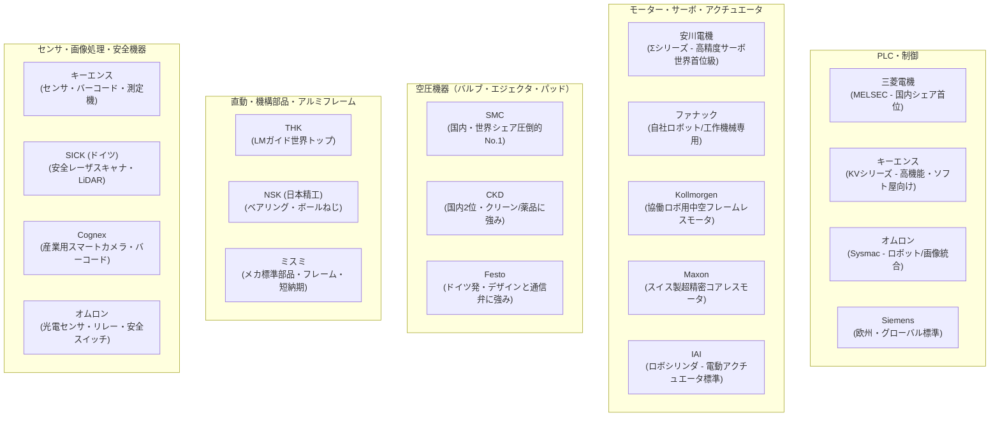
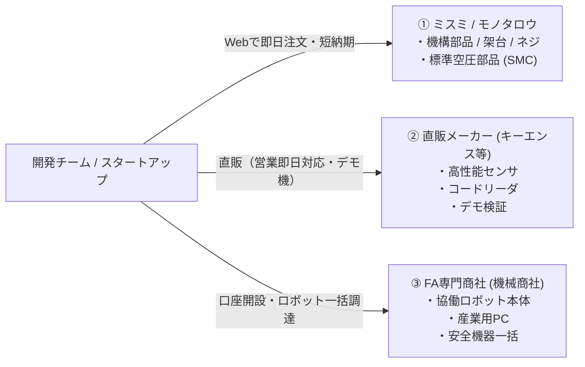

# FA業界の主要ベンダー勢力図・調達ルート・付き合い方完全マップ

ソフトウェアエンジニアがFA（工場自動化）やロボティクス分野に参入する際、最も戸惑うのが**「ハードウェアの調達先が多岐にわたり、Amazonのようにネットで即買いできない商慣習があること」**です。

本ドキュメントでは、FA業界で必ず耳にする主要メーカーの勢力図と、5人前後のスタートアップが手戻りなく部品を調達するためのルートと付き合い方をまとめます。

---

## 1. FA主要ベンダー勢力図（分野別）

---

### 分野別の特徴とスタンス

#### ① PLC・コントローラ
- **三菱電機（MELSEC）**：
  - **日本の工場のデファクトスタンダード**。町工場から大手自動車工場まで「PLC＝三菱」と言われるほど普及している。ラダー言語による開発が中心。既存ラインに接続・改造を求められたら9割型これ。
- **キーエンス（KVシリーズ）**：
  - C言語ライクなスクリプト記述、高速スキャン、使いやすい開発IDE、充実したデバッグ機能など**「ソフトウェアエンジニアが最も触りやすいPLC」**。本体・ソフトともに高価だが開発速度が段違いに速い。
- **オムロン（Sysmacシリーズ）**：
  - PLC、サーボ、画像センサ、安全機器を EtherCAT で1つのIDE（Sysmac Studio）に統合できる思想。EtherCAT機器との親和性が非常に高い。
- **シーメンス（Siemens S7シリーズ）**：
  - 欧州・北米案件で必須。IEC 61131-3（構造化テキスト：ST言語）によるプログラミングが標準。

#### ② モーター・サーボ
- **安川電機（Yaskawa）**：
  - 産業用サーボモーター（Σ-7 / Σ-Xシリーズ）で圧倒的な信頼性と国内シェア。応答性・制振制御が極めて優秀。
- **Kollmorgen（コルモーゲン / 米）**：
  - 協働ロボットのアーム関節内に組み込まれる**「フレームレス・中空シャフト・トルクモーター」**の世界標準（Universal Robots 等も採用）。
- **Maxon（マクソン / スイス）**：
  - 火星探査車や医療用ロボット、精密多指ハンドに多用される超高密度・高品質なコアレスモーター。
- **IAI（アイエイアイ）**：
  - **「ロボシリンダ」**（エアシリンダを置き換える小型電動スライダ・アクチュエータ）の国内標準。位置決めを多点で行いたいときに定番。

#### ③ 空圧機器（バキューム・電磁弁）
- **SMC**：
  - **日本の空圧機器シェア 60%超、世界シェア 30%超**。真空エジェクタ、吸着パッド、レギュレータ、電磁弁、継手（ワンタッチ管継手）のすべてが揃う。
  - 今回の Task 1（ボトル吸引）で必要な配管・バルブ・パッドは **SMC 製を選定しておけば絶対に失敗しない**。ロボット手先直結のグリッパ（ZXP7シリーズ等）も提供。
- **CKD**：
  - 国内2位。薬品・食品・クリーンルーム向けバルブやエアシリンダに強み。
- **Festo（フェスト / 独）**：
  - 欧州系自動化ラインで定番。バルブアイランド（Fieldbus/Ethernet直結の多連電磁弁）など通信統合に優れる。

#### ④ 直動・機構・フレーム
- **THK**：
  - **リニアモーション（LMガイド）のパイオニア**。直動案内やボールねじの代名詞。重荷重や高精度なスライダ軸を組む際の第一候補。
- **ミスミ（MISUMI）**：
  - アルミフレーム（架台）、プレート追加工、リニアガイド、プーリ、ボルト、ブラケットなど**自動化機構の標準部品をWeb上で3D CADから1個単位で即座に見積・翌日出荷**してくれる神インフラ。

#### ⑤ センサ・マシンビジョン・安全
- **キーエンス（KEYENCE）**：
  - センサ界の絶対王者。アンプ内蔵光電センサ、レーザ変位計、画像センサ、コードリーダなど、性能・使い勝手ともに最高峰。営業対応が即日かつ超強力（貸出デモ機がすぐ来る）。ただし価格は高い。
- **SICK（ジック / 独）**：
  - AGV/AMR や協働ロボットの安全エリア防護に使う**安全レーザスキャナ（Safety Laser Scanner）**の世界標準。
- **Cognex（コグネックス / 米）**：
  - マシンビジョン・工業用バーコードリーダの世界大手。PCレスで動くスマートカメラ（In-Sight）が有名。

---

## 2. 部品調達ルートの使い分け（どこで何を買うか）

スタートアップが直面する壁は、**「商社口座がないと売ってくれないメーカーがある」「1個だけの購入だと卸価格にならない」**という点です。以下の3ルートを使い分けます。

| 調達ルート | 主な購入品 | メリット | デメリット・注意点 |
| --- | --- | --- | --- |
| **ミスミ（MISUMI）** | アルミフレーム、ブラケット、ボルト、SMC継手・チューブ、センサブラケット | ・Web上で図面レス・追加工発注可能 ・3D CADデータを即ダウンロード可 ・納期が確定（最短翌日〜数日） | ・一部の特殊機器（ロボット本体や大型PLC等）は扱っていない |
| **モノタロウ（MonotaRO）** | 工具、配線資材（圧着端子・マークチューブ）、消耗品、標準リレー、電源 | ・小ロット・即日発送 ・法人後払い対応 | ・専門的なFA機器の選定相談・技術サポートはない |
| **メーカー直販（キーエンス等）** | 特殊センサ、高精度レーザ変位計、スマートカメラ | ・営業がデモ機を持って即座に現場・ラボに来る ・技術的な成立性を実機で検証してくれる | ・定価販売が基本（値引きが渋い） ・営業からの連絡頻度が高い |
| **FA専門商社 （機械工具商社・電材商社）** | 協働ロボット本体（Dobot/JAKA/UR等）、安全機器、産業用PC、制御盤部材一式 | ・定価より安く購入可能（卸値） ・複数メーカーを跨いだ選定相談が可能 ・メーカートラブル時の間に入ってくれる | ・**法人口座開設（与信審査）が必要**（スタートアップだと前入金指定される場合あり） ・WebではなくFAX/メール/見積書のやり取り |

---

## 3. スタートアップのための商社付き合い・発注のリアル

### ① 最初は「ミスミ ＋ モノタロウ」で8割揃える
PoC（実証実験）段階では、商社口座の開設を待つより **「ミスミでアルミフレーム架台＋SMC空圧部品、モノタロウでDC24V電源＋配線＋端子台」** を揃えるのが最もスピーディーです。

### ② ロボット本体の購入で「付き合いのある商社」を1社作る
ロボット本体（Dobot、JAKA、Fairino、URなど）は、原則として**国内正規代理店（商社）**経由で購入します。
- この代理店が、ロボット導入後の初期不良対応、技術サポート、周辺機器（グリッパ・架台・PC）の相談窓口になります。
- 創業間もないスタートアップの場合、**「最初は前金（100%前払い）」**を条件にすれば口座開設はスムーズに通ります。実績ができれば月末締め翌月末払いの売掛口座に切り替えられます。

### ③ 「完全型番指定」で見積もりを取る
商社に「ボトルの吸着パッドが欲しい」と相談すると、やり取りだけで数日かかります。
ミスミやSMCのWebカタログで **完全な型式記号（例：`ZPT25US-B5`）** を確定させてから、「この型番を1個、見積・納期回答ください」と依頼するのが、最も早く、安く手に入れるコツです。

---

## 4. Task 1（ボトルピッキング）における推奨調達リスト

| 部門 | 品名 | 推奨メーカー | 主な購入先 |
| --- | --- | --- | --- |
| **アーム** | 6軸協働ロボット（本体・コントローラ） | Dobot / JAKA / Fairino 等 | 国内正規代理店（商社） |
| **手先** | ロボット用真空グリッパユニット（ZXP7等） | SMC | 商社 または ミスミ |
| **空圧配管** | チューブ（φ6/φ8）、ワンタッチ継手 | SMC | ミスミ / モノタロウ |
| **センサ** | 透過型／回帰反射型光電センサ（DC24V） | オムロン（E3Z等） / キーエンス | ミスミ / 直販 |
| **電源** | スイッチング電源（AC100V→DC24V, 100W/240W） | オムロン（S8VK等） / TDKラムダ | ミスミ / モノタロウ |
| **カメラ** | PoE対応 RGB-Dカメラ または USB RGB-D | Orbbec / Intel RealSense | 直販 / 正規代理店 |
| **架台** | 40角アルミフレーム・天板・ブラケット | ミスミ | ミスミWeb |
| **PC** | 産業用PC（Core i5/i7 + RTX GPU, DC24V駆動） | Neousys / Advantech / Contec | 産業PC代理店（商社） |
