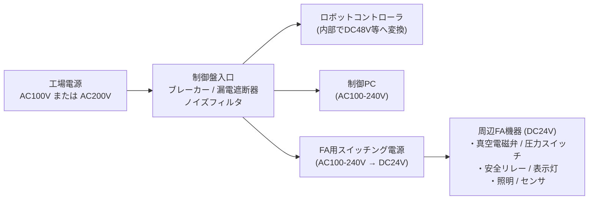

# 電源設計・降圧・配線方針

工場現場の電源事情と、ロボット・PC・周辺機器（DC24V系）への給電・降圧の基本構成です。

## 1. 全体電源構成イメージ

## 2. 工場電源（AC側）はどこから取るか？
- **単相100V コンセントがある場合**：
  - 小型協働ロボット（可搬3〜5kgクラス）＋制御PC＋周辺機器の合計消費電力は、通常 **500W〜1,000W（10A以下）** に収まることが多く、工場の単相100V（15A）系統から取れるケースが多い。
  - **注意**：コンプレッサーや大型モーターと同じ電源系統に繋ぐと、起動時の電圧降下やノイズでPC・カメラが落ちるため、できれば別系統（制御系コンセント）から取る。
- **200V（動力盤）しかない場合**：
  - ロボットコントローラやPCが `AC100-240V` ワイド入力対応なら単相200Vから給電可能。
  - 100V専用機器（モニターや一部ACアダプタ等）を繋ぐ場合は、盤内に **ダウントランス（200V → 100V 降圧）** を入れる。
- **⚠️ 海外製ロボット購入時の罠**：
  - 安価な海外メーカー機では **「AC220V専用（日本の100V不可）」** のモデルが稀にある。購入前に **「AC100V〜240V 対応か」** を必ず確認すること（非対応なら昇圧トランスが必要になる）。

## 3. 降圧（DC24V / 12V / 5V）はどうするか？

### ① FA機器（電磁弁・センサ・安全リレー）→ DC24V
- 工場の標準制御電圧は **DC24V**。
- 電子工作用の裸のDC-DC基板ではなく、**DINレール取付型のFA用スイッチング電源**（オムロン S8VK、コーセル、TDKラムダ等：AC100-240V → DC24V 5A程度）を制御盤内に設置する。
- ※ロボットコントローラ内蔵の「24V出力端子」は容量が小さい（1〜2A程度）ことが多いため、電磁弁や照明を複数動かす場合は外付け電源を用意するのが安全。

### ② カメラ・通信機器 → 5V (USB) / PoE / 12V
- **USBカメラ（RealSense等）**：PCのUSBポートから5V給電。工場でケーブルが長くなる（2〜3m以上）と電圧降下・ノイズで切断されやすいため、**産業用アクティブUSBケーブル**や**外部給電（セルフパワー）USBハブ**を使う。
- **PoEカメラ**：PoE対応スイッチングハブからLANケーブル1本で電源＋通信を送れるため、工場配線がスッキリしノイズにも強い。

## 4. ソフト屋さんがハマりやすい「電気ノイズ」対策
- **電磁弁（真空吸引バルブ）の逆起電力対策**：
  - 電磁弁のコイルをOFFにした瞬間にサージ電圧が発生し、近くを通るUSBカメラやPCがフリーズすることがある。
  - 電磁弁は**サージ保護回路（ダイオード／バリスタ）内蔵タイプ**を選び、動力線とUSB/LANケーブルは束ねずに離して配線する。
