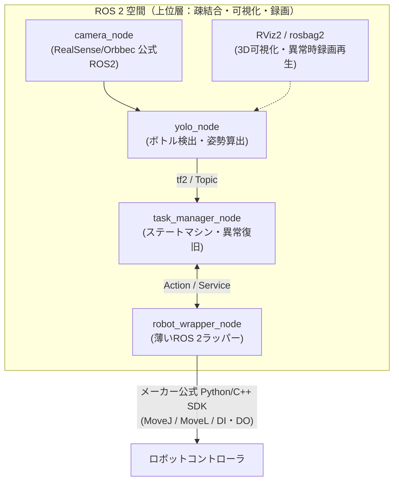

# ROS 2 を使うべきか？（ROS 2 vs メーカー公式 Python SDK）

ソフトウェア開発に慣れたチームが工場自動化（Task 1〜）を進めるにあたり、**ROS 2 を使うべきか／Python SDK 直接制御で組むべきか** の判断基準です。

## 1. 結論
- **最短で Task 1 を動かしたい・軌道が単純** なら **Python（メーカー公式 SDK）直接制御** でも十分成立する。
- **RViz での3D可視化・障害物回避（MoveIt 2）・Task 2 以降への横展開** を見据えるなら **ROS 2** のメリットが大きい。
- **重要**：100万円前後帯の協働ロボットは、**公式 ROS 2 ドライバの完成度にメーカー差がある**ため、機種選定時のドライバ確認が必須。

## 2. 比較表

| 観点 | ROS 2（MoveIt 2 / TF2 / RViz2） | Python 直接制御（メーカー公式 SDK） |
| --- | --- | --- |
| **立ち上げスピード** | △ ROS 2（DDS / URDF / MoveIt / colcon）の学習コストがかかる | **◎** 普通の Python アプリとして即書き始められる |
| **3D可視化・デバッグ** | **◎** RViz2 で「カメラ座標・ロボット姿勢・ボトル位置」を3Dで確認できる | △ 自前で可視化ツールを作るか、実機・ログ頼みになる |
| **座標変換（TF）** | **◎** `tf2` で Base / Camera / TCP 間の変換を標準管理できる | ○ NumPy / SciPy で 4×4 同次変換行列を自前実装（数式は単純） |
| **障害物回避** | **◎** MoveIt 2 にホッパーや壁を登録して衝突回避軌道を生成できる | △ 経由点（Waypoint）を人間が固定設計する |
| **機種変更・横展開** | **◎** カメラやロボットを別メーカーに変えても資産を使い回しやすい | △ メーカーごとの SDK にコードが依存しやすい |
| **ドライバの安定性** | △ 安価帯ロボットは ROS 2 ドライバが未成熟な場合がある | **◎** どのメーカーも Python / C++ SDK は基本動く |

## 3. 判断フロー（どちらを選ぶか）

1. **まず採用候補ロボットの「公式 ROS 2 ドライバ」の保守状況を確認する**
   - GitHub の更新頻度・対応バージョン（Humble / Jazzy）・実機での MoveIt 2 動作実績があるか。
2. **Task 1 の軌道が「単純な経由点移動」で済むかを確認する**
   - もし「①上空へ移動 → ②真下に降りて吸着 → ③真上に抜く → ④コンベア上空へ移動 → ⑤置く」の固定パターンで壁にもぶつからないなら、**MoveIt 2 はオーバースペック**になりやすく、Python SDK の方がシンプルで安定するケースも多い。
## 4. 第3の選択肢：「上側だけ ROS 2 ＋ 下側は公式 SDK ラッパー」（ハイブリッド構成）

**結論：今回の条件（100万円帯ロボット × ソフト系チーム × カメラ/他システム連携）では、このハイブリッド構成が最も現実的で「いいとこ取り」できる有力解です。**

MoveIt 2 や `ros2_control` は使わず、**「カメラ・YOLO・座標変換（TF2）・全体ステートマシン・他設備連携」の上位層だけを ROS 2 で組み、アーム制御ノードの中身だけメーカー公式 Python/C++ SDK を叩く**構成です。

### この構成が優れている理由
1. **メーカー ROS 2 ドライバの品質に左右されない**：安価帯ロボットで MoveIt 2 や `ros2_control` 対応が弱くても、Python SDK さえ動けば確実に制御できる。
2. **軌道が予測可能で安全**：MoveIt 2 のプランナが意図しない大回り軌道を生成する心配がなく、ロボットコントローラ内蔵の安定した `MoveJ` / `MoveL` をそのまま使える。
3. **ROS 2 の美味しい機能だけ使える**：
   - カメラの公式 ROS 2 パッケージ、**`tf2`（座標変換）**、**RViz2（3D可視化）**、**`rosbag2`（実機データの録画・オフライン再生デバッグ）** をそのまま活用できる。
   - 「YOLO担当」「全体制御担当」「ロボットラッパー担当」でチーム分業しやすい。

## 5. 産業用・工場ロボットで ROS 2 を使っていいのか？

**結論：使って問題ありません（大手産業用ロボットメーカーも公式に ROS 2 連携を提供しています）。ただし、「ROS 2 に任せていい領域」と「任せてはいけない領域」を明確に分けることが必須です。**

| 領域 | ROS 2 に任せるか | 理由・担当させるべき場所 |
| --- | --- | --- |
| **安全停止（非常停止・安全柵・衝突停止）** | **❌ 絶対NG** | ROS 2 / 汎用 Linux は安全認証（ISO 13849-1 等）を持たない。必ず**コントローラ・安全リレーのハード回路**に任せる |
| **モーターのリアルタイムサーボ制御** | **❌ NG** | 1ms周期等の厳密なリアルタイム制御は**ロボットコントローラ内部の制御CPU**に任せる |
| **ビジョン・AI推論・座標変換・タスク指示** | **⭕ OK（推奨）** | 「どこを吸ってどこに置くか」の計算・状態管理・可視化・ログ録画は ROS 2 の得意領域 |

> **ポイント**：前述の「上側だけ ROS 2 ＋ 下側はコントローラ内蔵の `MoveJ`/`MoveL` を呼ぶハイブリッド構成」は、まさにこの**安全な責任分界点**に沿った設計です。

### 工場現場で ROS 2 を運用する際の3つのルール
1. **DDS 通信を工場ネットワークに漏らさない**
   - デフォルトの DDS はマルチキャスト通信を行うため、工場の社内LANにそのまま流すと他設備の迷惑になる。単一PC内で完結させる（`ROS_LOCALHOST_ONLY=1` または `ROS_AUTOMATIC_DISCOVERY_RANGE=LOCALHOST`）か、閉じた制御用セグメントに隔離する。
2. **LTS バージョン固定 ＋ Docker 化**
   - 必ず長期サポート版（**Humble** または **Jazzy**）を選び、Docker イメージでバージョンを固定して勝手にアップデートされないようにする。
3. **現場作業員に ROS 2 やコマンド操作を意識させない**
   - 工場の作業員に「ターミナルを開いて `ros2 launch` や `docker` コマンドを打つ」といった操作を求めない設計にする（コマンド操作は開発・保守チームが SSH 等で使うだけにする）。
   - **現場の標準操作**：
     - **起動**：工場の電源投入で PC・Docker・ROS 2 が自動起動する。
     - **日常操作**：制御盤の**物理ボタン（起動 / 一時停止 / リセット / 非常停止）**と**パトランプ（緑・黄・赤）**だけで完結させる。
     - **画面が必要な場合**：ブラウザ上のシンプルな日本語 Web UI（処理状況・カメラ映像・リセットボタン等）を全画面表示し、Linux のデスクトップや黒い画面は見せない。

## 6. FAQ：ROS-Industrial は使わなくていいのか？
**結論：今回は不要です。**
- **ROS-Industrial** は、主に従来型の大型産業用ロボット（FANUC・安川・ABB・KUKA 等）を ROS から扱うためのドライバ群や、連続パス計画（Tesseract 等）を提供するプロジェクトです。
- 現在の ROS 2 世代では、多くの協働ロボットがメーカー独自の ROS 2 ドライバまたは Python SDK を直接提供しており、さらに 100万円前後帯の協働ロボットはそもそも ROS-Industrial の対象外であることがほとんどです。
- 今回は「上側だけ標準 ROS 2 ＋ 下側はメーカー公式 Python SDK ラッパー」で十分シンプルに組めるため、ROS-Industrial を導入する必要はありません。

## 7. FAQ：C++ ではなく Python でいいのか？
**結論：はい、今回は Python メインでまったく問題ありません（開発スピード的にも Python 推奨）。**
- **重い処理の中身はすでに C++ / CUDA**：YOLO（PyTorch / TensorRT）、OpenCV、NumPy、RealSense/Orbbec SDK は内部が C++ / CUDA で動くため、Python から呼び出しても推論や座標計算は数ms〜十数msで終わります。
- **ロボットの物理動作（1〜3秒）が律速**：上位のステートマシンや座標計算を C++ で書いて数ms速くしても、全体のタクトタイムにはほぼ影響しません。
- **例外的に C++ が要るケース**：将来 1ms 周期のリアルタイムサーボ制御（`ros2_control` ドライバ自作）を PC 側で行う場合や、メーカーが C++ SDK しか提供していない場合のみ、その部分だけを C++ で書けば十分です。
