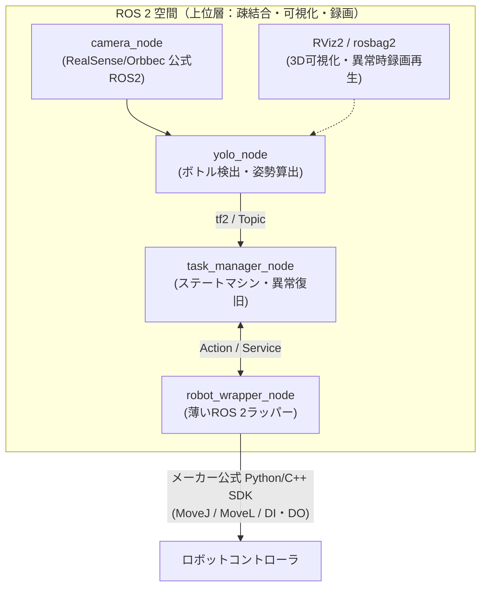

# ROS 2 を使うべきか？（ROS 2 vs メーカー公式 Python SDK）

ソフトウェア開発に慣れたチームが工場自動化（Task 1〜）を進めるにあたり、**ROS 2 を使うべきか／Python SDK 直接制御で組むべきか** の判断基準です。

## 1. 結論
- **最短で Task 1 を動かしたい・軌道が単純** なら **Python（メーカー公式 SDK）直接制御** でも十分成立する。
- **RViz での3D可視化・障害物回避（MoveIt 2）・Task 2 以降への横展開** を見据えるなら **ROS 2** のメリットが大きい。
- **重要**：100万円前後帯の協働ロボットは、**公式 ROS 2 ドライバの完成度にメーカー差がある**ため、機種選定時のドライバ確認が必須。

## 2. 比較表

| 観点 | ROS 2（MoveIt 2 / TF2 / RViz2） | Python 直接制御（メーカー公式 SDK） |
| --- | --- | --- |
| **立ち上げスピード** | △ ROS 2（DDS / URDF / MoveIt / colcon）の学習コストがかかる | **◎** 普通の Python アプリとして即書き始められる |
| **3D可視化・デバッグ** | **◎** RViz2 で「カメラ座標・ロボット姿勢・ボトル位置」を3Dで確認できる | △ 自前で可視化ツールを作るか、実機・ログ頼みになる |
| **座標変換（TF）** | **◎** `tf2` で Base / Camera / TCP 間の変換を標準管理できる | ○ NumPy / SciPy で 4×4 同次変換行列を自前実装（数式は単純） |
| **障害物回避** | **◎** MoveIt 2 にホッパーや壁を登録して衝突回避軌道を生成できる | △ 経由点（Waypoint）を人間が固定設計する |
| **機種変更・横展開** | **◎** カメラやロボットを別メーカーに変えても資産を使い回しやすい | △ メーカーごとの SDK にコードが依存しやすい |
| **ドライバの安定性** | △ 安価帯ロボットは ROS 2 ドライバが未成熟な場合がある | **◎** どのメーカーも Python / C++ SDK は基本動く |

## 3. 判断フロー（どちらを選ぶか）

1. **まず採用候補ロボットの「公式 ROS 2 ドライバ」の保守状況を確認する**
   - GitHub の更新頻度・対応バージョン（Humble / Jazzy）・実機での MoveIt 2 動作実績があるか。
2. **Task 1 の軌道が「単純な経由点移動」で済むかを確認する**
   - もし「①上空へ移動 → ②真下に降りて吸着 → ③真上に抜く → ④コンベア上空へ移動 → ⑤置く」の固定パターンで壁にもぶつからないなら、**MoveIt 2 はオーバースペック**になりやすく、Python SDK の方がシンプルで安定するケースも多い。
## 4. 第3の選択肢：「上側だけ ROS 2 ＋ 下側は公式 SDK ラッパー」（ハイブリッド構成）

**結論：今回の条件（100万円帯ロボット × ソフト系チーム × カメラ/他システム連携）では、このハイブリッド構成が最も現実的で「いいとこ取り」できる有力解です。**

MoveIt 2 や `ros2_control` は使わず、**「カメラ・YOLO・座標変換（TF2）・全体ステートマシン・他設備連携」の上位層だけを ROS 2 で組み、アーム制御ノードの中身だけメーカー公式 Python/C++ SDK を叩く**構成です。

### この構成が優れている理由
1. **メーカー ROS 2 ドライバの品質に左右されない**：安価帯ロボットで MoveIt 2 や `ros2_control` 対応が弱くても、Python SDK さえ動けば確実に制御できる。
2. **軌道が予測可能で安全**：MoveIt 2 のプランナが意図しない大回り軌道を生成する心配がなく、ロボットコントローラ内蔵の安定した `MoveJ` / `MoveL` をそのまま使える。
3. **ROS 2 の美味しい機能だけ使える**：
   - カメラの公式 ROS 2 パッケージ、**`tf2`（座標変換）**、**RViz2（3D可視化）**、**`rosbag2`（実機データの録画・オフライン再生デバッグ）** をそのまま活用できる。
   - 「YOLO担当」「全体制御担当」「ロボットラッパー担当」でチーム分業しやすい。
