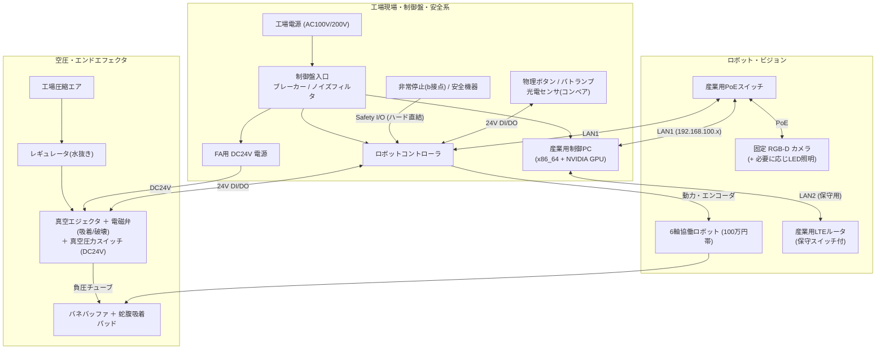
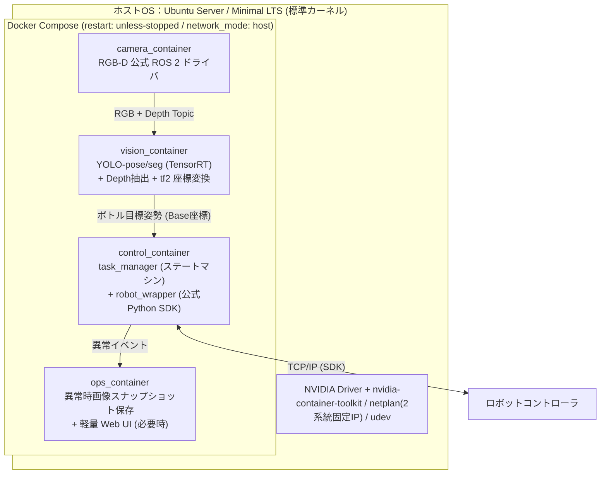

# システム全体アーキテクチャ（Task 1 ハード・ソフト構成）

ここまでの検討を統合した、Task 1（空ボトル ピック＆プレース自動化）の **ハードウェア構成** と **ソフトウェア構成** の全体像です。

---

## 1. ハードウェア構成（機器一覧と役割）

### ハードウェア部品構成まとめ

| カテゴリ | 機器・部品 | 役割・選定ポイント |
| --- | --- | --- |
| **ロボット** | 6軸協働ロボット ＋ コントローラ | 本体100万円前後帯。公式 Python SDK・AC100-240V・Safety I/O を確認 |
| **吸着・空圧** | 蛇腹吸着パッド ＋ バネバッファ ＋ エジェクタ ＋ 電磁弁（吸着/破壊）＋ 真空スイッチ | 空ボトル＋形状差を吸収。電磁弁はサージ保護内蔵、極性（PNP/NPN）合わせ必須 |
| **ビジョン** | 固定 RGB-D カメラ（PoE推奨 / PoCはUSB3） | 作業エリア上方に固定（Eye-to-Hand）。必要に応じてLED照明・遮光カバー |
| **制御PC** | 産業用PC（Intel x86_64 + NVIDIA GPU, LAN×2） | Ubuntu LTS。復電自動起動、防塵・耐熱対応（※同型予備機を社内に1台推奨） |
| **ネットワーク** | 産業用 PoE スイッチ（DC24V）＋ 産業用 LTE ルータ | 制御閉域LAN（NIC1）と保守VPN（NIC2）を物理分離 |
| **制御盤・安全** | 制御盤（施錠）、DC24V電源、非常停止（b接点）、起動/停止/リセットボタン、パトランプ、光電センサ | 非常停止はハード直結。作業員は物理ボタンとパトランプのみで操作 |

---

## 2. ソフトウェア構成（ホストOS ＋ Docker ＋ ROS 2 ハイブリッド）

### 各コンテナ・モジュールの責務
1. **`camera_container`**：カメラから RGB 画像・Depth 画像・内部パラメータを配信。
2. **`vision_container`**：YOLO-pose（口・底）または YOLO-seg を TensorRT で高速推論し、Depth から 3D 座標を取得、`tf2`（Hand-Eye キャリブレーション済み）でロボット Base 座標に変換して配信。
3. **`control_container`**：
   - `task_manager_node`：待機・自動運転・吸着リトライ・安全退避・異常停止を管理するステートマシン。
   - `robot_wrapper_node`：MoveIt 2 を使わず、内部でメーカー公式 Python SDK を叩いて `MoveJ` / `MoveL`・24V DI/DO（吸着・真空スイッチ・コンベア信号）を制御する薄いラッパー。
4. **`ops_container`**：エラー瞬間の画像・ログ自動保存、世代管理削除、必要に応じたブラウザ確認用軽量 Web UI を提供。

---

## 3. 詳細ドキュメント一覧

| レイヤ | 詳細ドキュメント |
| --- | --- |
| **ロボット本体** | [`robot_selection.md`](./robot_selection.md) |
| **エンドエフェクタ** | [`end_effector_selection.md`](./end_effector_selection.md) |
| **ビジョン・AI** | [`vision_and_ai.md`](./vision_and_ai.md) |
| **コントローラ・ROS 2** | [`controller_and_pc.md`](./controller_and_pc.md) / [`ros2_vs_python_sdk.md`](./ros2_vs_python_sdk.md) |
| **制御PC** | [`pc_selection.md`](./pc_selection.md) |
| **電源・配線** | [`power_and_wiring.md`](./power_and_wiring.md) |
| **OS・ネットワーク・セキュリティ** | [`os_and_network_setup.md`](../05_operations/os_and_network_setup.md) |
