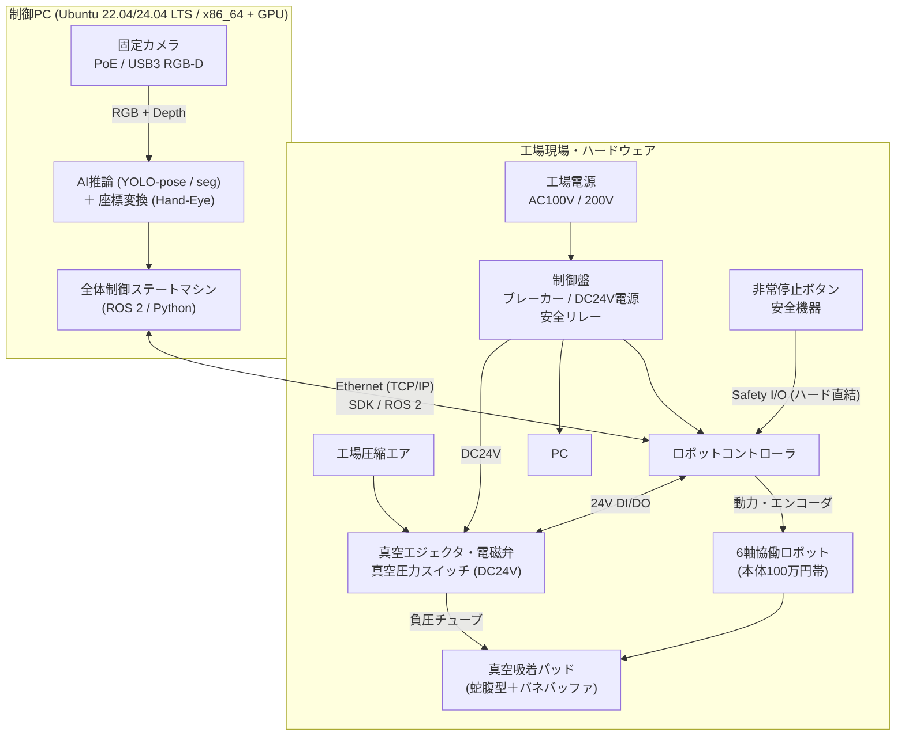

# システム全体アーキテクチャ（Task 1 想定構成）

ここまでの検討（6軸協働ロボット・真空吸引・RGB-D＋YOLO・Ubuntu IPC・DC24V電源）を統合した全体構成図です。

## 構成サマリーと関連ドキュメント

| レイヤ | 採用方針 | 詳細ドキュメント |
| --- | --- | --- |
| **ロボット本体** | 6軸協働ロボット（本体100万円前後帯） | [`robot_selection.md`](./robot_selection.md) |
| **エンドエフェクタ** | 真空吸引（蛇腹パッド＋バネバッファ＋真空スイッチ） | [`end_effector_selection.md`](./end_effector_selection.md) |
| **ビジョン・AI** | 固定 RGB-D カメラ ＋ YOLO-pose / seg（PoE推奨、PoCはUSB可） | [`vision_and_ai.md`](./vision_and_ai.md) |
| **コントローラ連携** | Ethernet (TCP/IP) 経由で座標・I/O指令、安全回路はハード直結 | [`controller_and_pc.md`](./controller_and_pc.md) |
| **制御PC・OS** | Ubuntu LTS（x86_64 + NVIDIA GPU）、本番は産業用IPC | [`pc_selection.md`](./pc_selection.md) |
| **電源・配線** | AC100/200V分岐 ＋ FA用DC24Vスイッチング電源＋サージ対策 | [`power_and_wiring.md`](./power_and_wiring.md) |
