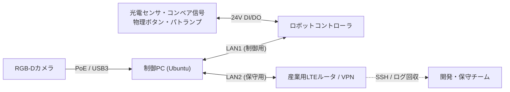

# 外部連携・保守運用ガイド

制御PCをロボットコントローラ以外に何と繋ぐべきか、また工場導入後の保守・メンテナンスをどう設計すべきかをまとめます。

## 1. 制御PCは「ロボットコントローラだけ」に繋げばいいのか？

**結論：ロボット以外にも「カメラ」「周辺設備（コンベア等）」「保守用回線」との接続設計が必要です。**

### ① カメラ（必須）
- PCへ直接接続（PoEスイッチ経由のLAN、またはUSB3）。

### ② 工場設備（コンベア・センサ・表示灯・物理ボタン）
- ロボットが単独で動くと「コンベア上にまだボトルがあるのに上から置く」「受け場が空なのに待機し続ける」といった問題が起きるため、以下の信号連携がほぼ必須になります。
  - **ワーク有無センサ（光電センサ）**：コンベアの置き場が空いているか
  - **コンベア稼働状態**：動いているか／停止しているか
  - **物理ボタン・シグナルタワー（パトランプ）**：現場作業員が「起動・停止・リセット」や異常状態（赤/黄/緑）を一目で把握できるようにする
- **繋ぎ方のコツ**：PCにUSB-IOアダプタを増やすより、**「ロボットコントローラの 24V DI/DO 端子（またはPLC）に繋ぎ、PCはコントローラ経由で読む」**構成にすると配線・故障切り分けがシンプルになります。

### ③ 画面UI（HMI）は作る必要があるか？
- **必須ではありません**。品種切替がなく「起動・停止・リセット」だけなら、**物理ボタン＋パトランプだけ（モニター・マウス無し）**の方が故障や誤操作が減り、工場現場でも好まれます。
- ただし、**「停止理由の日本語表示（吸着失敗 / カメラエラー等）」「YOLO認識映像の確認」「品種切替」**が現場で必要になる場合は、**1ページの軽量な Web UI**（タブレットや保守PCのブラウザから見られる構成）を用意すると運用・切り分けが格段に楽になります。

### ④ 既存工場の PLC（コンベア等）との通信・連携方法
コンベアや2階からの供給装置は、工場既存の **PLC（三菱電機 / キーエンス / オムロン等）** で動いているケースが大半です。PC やロボットコントローラとの連携には以下の3パターンがあります。

| 連携方式 | 仕組み | メリット・現場での現実 |
| --- | --- | --- |
| **1. 24V DI/DO（リレー接点）連携** | 既存 PLC とロボットコントローラを 24V 信号線 2〜4本で繋ぐ（「運転中」「置きOK」「完了」等） | **◎ 一番おすすめ**。プロトコル差異や極性（NPN/PNP）も絶縁リレーを噛ませれば解決でき、既存PLCの改造も最小限で済む |
| **2. Ethernet 通信（Modbus TCP / MCプロトコル等）** | LAN 経由で PC（Python：`pymodbus` 等）やロボットから PLC のレジスタを読み書きする | 情報量が多い場合に有効。ただし**既存 PLC に LAN ポートがない／プログラム変更不可（パスワードロック・保守契約）**の壁に当たりやすい |
| **3. 既存 PLC と繋がず独立運用** | ロボット側に後付けの**光電センサ**を付け、コンベアの状態を自前で見て置く | **◎ 現実的な最適解になりやすい**。既存設備に一切手を加えられない場合に有効 |

> **現場のリアル：「既存 PLC に繋ぐ」のはハードルが高いことが多い**
> 実際の既存工場では、**「他社製ラインの保証が切れる」「PLCにパスワードがかかっていてプログラム変更できない」「ラインを止めて改造できない」**といった理由で、既存 PLC を触らせてもらえないケースが多々あります。
> そのため、後付け協働ロボット案件では **「既存設備には一切手を加えず（方法3：後付けの光電センサ等で状態を見る）、電源とエアだけ借りて独立稼働させる」** のが最もスムーズに導入できる現実解になりやすいです（もし信号をもらう場合も、PLC プログラム改造ではなく「既存モーター稼働リレーから無電圧接点を1つ分岐してもらう」程度に留めるのが定石です）。

### ③ 保守・リモート監視用ネットワーク
- 工場の社内LANはセキュリティ上繋げないケースが多いため、**LANポート2つ目**に **産業用LTEルータ（SIM入り）＋ VPN（Tailscale / WireGuard 等）** を繋いでおくと、遠隔からログ確認や障害調査ができます。
- ※安全規格上、**遠隔からのロボット起動・非常停止解除は原則NG**。あくまで「監視・ログ回収・設定確認」用途に限定します。

---

## 2. 導入後の保守（メンテナンス）設計

ソフト屋チームが忘れがちな「工場で半年・1年と動かし続けるための保守設計」です。

### ① ソフトウェア・AI保守
- **エラー時スナップショット自動保存（最重要）**
  - 「吸着失敗」「認識エラー」で止まった瞬間の **RGB画像・Depth画像・YOLO推論結果・ロボット座標** を SSD に自動保存する（現場から「昨日止まった」と言われても画像がなければ原因特定できないため）。
- **モデル再学習の運用**
  - 新しい形状・色のボトルが増えたときに、現場画像を回収して YOLO を再学習・差し替えできる手順を用意する。
- **死活監視・ログローテーション**
  - ログで SSD が溢れて OS が止まらないよう、`logrotate` や古い画像の自動削除を必ず入れる。

### ② ハードウェア・消耗品保守（定期点検項目）

| 対象 | 起きるトラブル | 保守対策 |
| --- | --- | --- |
| **真空吸着パッド** | ゴムの摩耗・硬化・粉塵付着で吸着力が落ちる | **消耗品として予備を常備**。工具なしで数分で交換できる継手構造にしておく |
| **エアフィルタ / エジェクタ** | 圧縮エアの水分（ドレン）や油分で詰まる | レギュレータのドレン抜き・フィルタ清掃を定期点検リストに入れる |
| **カメラレンズ・位置ズレ** | 粉塵で曇る／清掃時に手が当たって数mmズレる | 定期的なレンズ拭き＋**マーカを置くだけの簡易再キャリブレーション手順**を用意 |
| **産業用PC** | 防塵フィルタの目詰まり・熱暴走 | フィルタ清掃・予備機（コールドスタンバイ）の確保 |
| **ロボット本体** | ケーブルの屈曲摩耗・グリス劣化・バックアップ電池切れ | メーカー推奨の定期点検スケジュールに従う |
