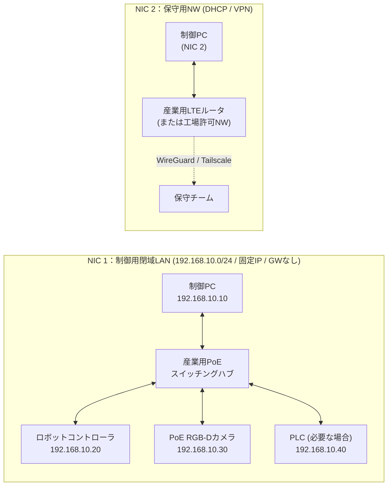

# OS設定・ネットワーク構築ガイド（Ubuntu LTS ＋ 工場LAN分離）

制御PC（Ubuntu 22.04 / 24.04 LTS）を工場の本番環境で長期安定稼働させるための、OS設定とネットワーク設計の実務ガイドです。

---

## 1. ネットワーク構成（物理2系統分離が鉄則）

工場の制御ネットワーク（ロボット・カメラ）と、保守用ネットワーク（外部/社内）は**物理的に NIC を分ける**のが最も安全でトラブルが少ないです。



### ネットワーク設計・構築の注意点（現場の落とし穴）
1. **制御用 LAN（NIC 1）は「固定IP・デフォルトゲートウェイなし」**
   - DHCP にすると再起動で IP が変わりロボットやカメラを見失うため、必ず固定 IP にする。
   - デフォルトゲートウェイ（GW）を空にしておくことで、保守用 NIC（NIC 2）側とのルーティング競合を防ぐ。
2. **ありふれたサブネット（`192.168.0.x` / `1.x`）を避ける**
   - `192.168.0.0/24` や `192.168.1.0/24` は LTE ルータ・工場内機器・VPN の初期値と衝突しやすいため、`192.168.100.0/24` や `10.10.10.0/24` 等を使う。
3. **リンクダウン時に IP を消さない（NetworkManager の罠）**
   - Desktop 版の NetworkManager は、ロボット側の電源を落として LAN がリンクダウンすると PC 側の IP を消すことがある。制御用 NIC は **`netplan`（`systemd-networkd`）で固定設定**にしておく。
4. **産業用スイッチングハブ（DC24V）と配線分離**
   - 家庭用ハブ（ACアダプタが抜けやすく耐熱性が低い）は避け、**DINレール取付・金属筐体・DC24V駆動の産業用スイッチ**を使う。
   - LAN ケーブルは抜け防止ラッチ付き（Cat6A 等）を選び、AC電源線やロボット動力線と束ねて配線しない。
5. **NIC 省電力機能（EEE）の無効化と PoE カメラ帯域**
   - GigE / PoE カメラでフレーム落ちや遅延スパイクが出る場合は、スイッチと NIC の `MTU 9000`（Jumbo Frame）設定や、省電力機能（EEE: Energy Efficient Ethernet）の無効化を行う。
6. **ROS 2 DDS の通信隔離**
   - 単一 PC 内で ROS 2 が完結するなら `ROS_LOCALHOST_ONLY=1`（Jazzy 以降は `ROS_AUTOMATIC_DISCOVERY_RANGE=LOCALHOST`）を設定する。
   - マルチキャストが保守用 NIC 側に漏れないよう、CycloneDDS を使う場合は XML 設定でインタフェース（NIC 1）を明示指定する。

---

## 2. Ubuntu エディション選び（Server / Desktop / Core）と不要機能の整理

### ① どのエディションを選ぶべきか？

| エディション | 推奨度 | 特徴と現場での評価 |
| --- | --- | --- |
| **Ubuntu Server LTS** | **◎（本番最適）** | GUI がなく軽量・安定。GPU VRAM やメモリを余計に消費せず、不要な常駐ソフトも少ない。保守は SSH / Web UI で十分 |
| **Ubuntu Desktop LTS（Minimal）** | **○（開発・PoC・画面必須時）** | 現場で急遽 RViz2 やカメラ映像を直接モニターに映したい場合に便利。必ず **Minimal Installation（最小構成）** を選ぶ |
| **Ubuntu Core** | **❌ 非推奨** | Snap 前提の特殊な不変 OS。NVIDIA GPU ドライバ・`nvidia-container-toolkit`・カメラ SDK・`udev` 設定でハマりやすく FA 開発には不向き |

### ② デフォルトで入っているものはそのままでいいか？
**本番機ではそのままにせず、不要なサービスやアプリを削る（最初から Server または Desktop Minimal を入れる）のが鉄則です。**

- **特に注意・無効化すべきもの**：
  - **`snap` 版 Docker は使わない**：Ubuntu インストーラのオプションで入る Snap 版 Docker はデバイスアクセスや権限周りでトラブルが多いため、必ず **Docker 公式の `apt` リポジトリ（Docker CE）** から入れる。
  - **不要サービスの停止**：`unattended-upgrades`（自動更新）、`bluetooth`、`cups`（印刷）、`avahi-daemon`（mDNS で不要なパケットを撒く）を停止・削除する。
  - **Desktop 版で普段モニターを繋がない場合**：自動ログインや GUI デスクトップ（`gdm3`）が GPU VRAM を消費するため、本番運用時は CUI 起動（`systemctl set-default multi-user.target`）にすると安定性と VRAM 余裕が増す。

### なぜ他の Linux ではなく「Ubuntu LTS」なのか？
- **ROS 2 の Tier 1 公式サポート**：ROS 2 Humble（Ubuntu 22.04 LTS）および Jazzy（Ubuntu 24.04 LTS）は Ubuntu が第一級サポート対象。Debian や Rocky Linux 等ではソースビルドや依存関係のトラブルが増えやすい。
- **GPU（CUDA / TensorRT）＆ メーカーSDKの標準**：NVIDIA ドライバ、RealSense / Orbbec SDK、ロボットメーカーの Linux SDK はほぼすべて Ubuntu LTS 前提で検証・配布されている。
- **22.04 LTS と 24.04 LTS の選び方**：採用予定の**ロボット SDK とカメラ SDK の両方が公式対応している新しい方の LTS** を選ぶ（未対応ならホストは 22.04/24.04 でも Docker 内を 22.04 Humble に合わせる）。
- **`PREEMPT_RT`（リアルタイムカーネル）は不要**：1ms周期のサーボ制御はロボットコントローラ側が担当し、PCからは座標指令（`MoveJ`/`MoveL`）を送るだけのため標準カーネルで十分。むしろ `PREEMPT_RT` は NVIDIA GPU ドライバと相性が悪く不安定になりやすいため入れない方が安全。

---

## 3. Ubuntu 本番設定チェックリスト

開発用 PC の初期設定のまま工場に入れると、自動アップデートやスリープで突然止まります。出荷前に以下を必ず設定します。

### ① 自動アップデート・スリープの無効化（最優先）
- **自動更新を止める**：稼働中にカーネルや NVIDIA ドライバが更新されて GPU が認識できなくなる事故を防ぐ。
  - `unattended-upgrades` を無効化（`/etc/apt/apt.conf.d/20auto-upgrades` で `0` に設定）。
- **スリープ・休止を完全無効化**：
  - `sudo systemctl mask sleep.target suspend.target hibernate.target hybrid-sleep.target`

### ② 復電自動起動とアプリ自動立ち上げ
- **BIOS 設定**：`Restore on AC Power Loss`（AC電源復帰時の動作）を **`Power On`** に設定。
- **アプリ自動起動**：Docker Compose の `restart: unless-stopped` または `systemd` サービスを登録し、電源投入から 1〜2 分以内に自動で待機状態に入るようにする。

### ③ USB・省電力・ハード周り
- **USB Auto-suspend 無効化**：USB カメラを使う場合、カーネルパラメータ `usbcore.autosuspend=-1` を設定して勝手に省電力切断されるのを防ぐ。
- **デバイス名の固定（udev ルール）**：シリアル変換（RS-485等）や USB 機器を複数繋ぐ場合、`/dev/ttyUSB0` は再起動で入れ替わるため、シリアル番号ベースの `udev` ルールで `/dev/robot_io` のように固定シンボリックリンクを作る。

### ④ ディスク容量溢れの防止（工場で一番多い長期稼働トラブル）
- **Docker ログローテーション**：`/etc/docker/daemon.json` に以下を設定してログ肥大化を防ぐ。
  ```json
  {
    "log-driver": "json-file",
    "log-opts": {
      "max-size": "50m",
      "max-file": "5"
    }
  }
  ```
- **journald の上限設定**：`/etc/systemd/journald.conf` で `SystemMaxUse=500M` 等を指定。
- **エラー時画像の世代管理**：保存した RGB/Depth 画像が SSD を埋め尽くさないよう、一定日数経過または容量閾値で古い画像から削除するスクリプトを `cron` / `systemd timer` で回す。

### ⑤ セキュリティ・時刻同期
- **SSH**：パスワードログインを無効化し、公開鍵認証のみ許可。ファイアウォール（`ufw`）で保守用ポート（SSH 等）以外を閉じる。
- **時刻同期**：閉域環境でもログとエラー画像の時刻がズレないよう、保守回線側で NTP（`chrony`）を合わせるか、制御PCのハードウェアクロック（RTC）を定期的に合わせる。

---

## 3. 工場（OT）セキュリティ対策：「大丈夫か？」への設計回答

工場のセキュリティでは、情報漏洩だけでなく **「外部から乗っ取られてロボットが勝手に動かないこと」「工場の社内LANと相互感染しないこと」** が最優先になります。

| リスク | 対策設計 |
| --- | --- |
| **工場LANとの相互感染（ランサムウェア等）** | 工場の社内LANには繋がない。保守回線は**独立した産業用LTEルータ**を使い、工場ネットワークから完全に切り離す（顧客のIT部門に最も説明しやすい構成） |
| **インターネットからの不正アクセス** | インバウンドポートは全閉（グローバルIPを持たない）。接続は **VPN（WireGuard / Tailscale 等）＋ SSH公開鍵認証** のみに限定する |
| **常時接続への不安（アタックサーフェス削減）** | 制御盤に**「保守スイッチ（物理キースイッチ等）」**を設け、**普段はLTEルータの電源をOFF**にしておき、保守時だけ現場にONにしてもらう運用が最も堅牢 |
| **保守NICからロボットへの直接侵入** | Linux の IPフォワーディングを無効化（`net.ipv4.ip_forward = 0`）し、NIC 2（保守）から NIC 1（ロボット）へ直接ルーティングさせない |
| **乗っ取りによる安全事故** | 非常停止・安全柵・安全制限はハードウェア安全回路側で完結させ、コントローラの**安全設定パスワードを初期値から変更**する |
| **現場での物理改ざん・USB差し込み** | 制御盤（ボックス）を**施錠管理**し、不要なUSBポート・物理アクセスを塞ぐ。アプリは一般ユーザ権限（非root）で動かす |
