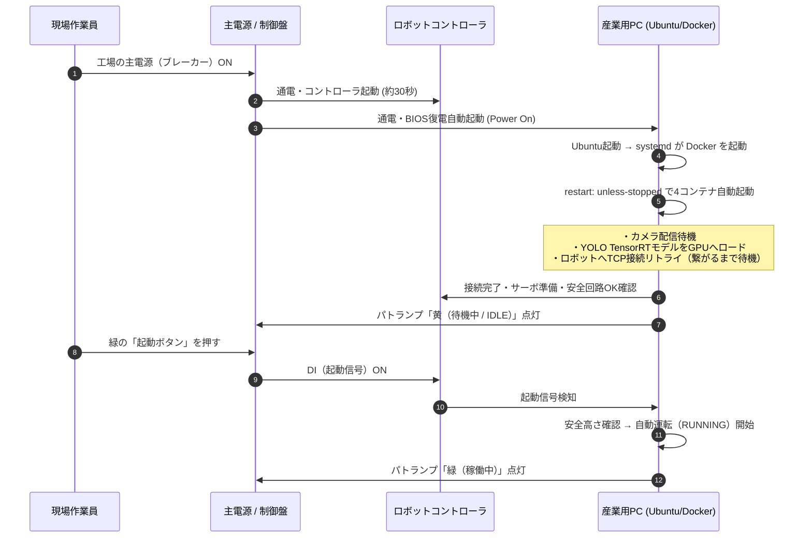

# PCのソフトウェア構成と自動起動シーケンス

制御PC（Ubuntu）に**「何のソフトを用意し、電源ONからどうやって自動起動させるか」**の実務設計です。

---

## 1. 用意するソフトウェア一覧

### ① ホストOS側（Ubuntu Server / Minimal LTS に直接入れるもの）
ホスト側は最小限に保ち、ROS 2 や Python ライブラリは直接入れません。
- **GPU 基盤**：NVIDIA Driver ＋ `nvidia-container-toolkit`
- **コンテナ基盤**：Docker Engine（公式 `apt` 版）＋ Docker Compose
- **ネットワーク・保守**：`netplan`（2系統固定IP）、`openssh-server`、VPN（Tailscale / WireGuard）、`ufw`、`chrony`
- **運用補助**：`udev` ルール（USB機器固定）、古いログ/画像の削除タイマー

### ② アプリ側（Docker Compose コンテナ内に用意するもの）

| コンテナ | 中に入っているソフト / ライブラリ | 役割 |
| --- | --- | --- |
| **`camera`** | ROS 2 + カメラ公式 ROS 2 パッケージ（RealSense / Orbbec 等） | RGB・Depth 画像とカメラ内部パラメータの配信 |
| **`vision`** | ROS 2 + PyTorch / TensorRT + Ultralytics YOLO + OpenCV + `tf2_ros` | YOLO-pose/seg 推論、Depth 抽出、Base 座標への変換 |
| **`control`** | ROS 2 + メーカー公式 Python SDK + 自作ステートマシン | `task_manager`（状態管理）＋ `robot_wrapper`（移動・24V I/O） |
| **`ops`** | Python (FastAPI 等) + 画像保存ワーカー | 異常時画像スナップショット保存、状態監視、必要時のみ軽量 Web UI |

---

## 2. 電源ON〜稼働開始までの自動起動シーケンス

工場の作業員がターミナルを一切触らず、**「主電源ON → 待機 → 緑ボタンを押して稼働」** となる起動フローです。



### 起動設計でハマりやすい3つのポイント
1. **PC とロボットの起動タイミング差を吸収する**
   - PC の方が先に立ち上がる場合も、ロボットの方が先に立ち上がる場合もあるため、`robot_wrapper` は**「繋がらなければ即死せず、数秒おきに接続リトライし続ける」**ように実装する。
2. **YOLO モデルの初回ウォームアップを待機中に済ませる**
   - TensorRT エンジンは最初の1回目の推論だけ数秒かかることがあるため、コンテナ起動直後にダミー画像で1回推論（ウォームアップ）を済ませてから `IDLE` 状態に入る。
3. **停止・シャットダウン手順**
   - 工場の主電源をいきなり落とす運用になることもあるため、OS・アプリは**ファイル書き込みを最小限（読み取り専用またはフラッシュ済みログ）**にし、万が一の電源断でもファイルシステムが壊れにくい ext4 ジャーナリング＋Docker 自動復旧構成にする（理想は停止ボタン後にシャットダウン）。

---

## 3. 実装用 Git リポジトリの構成イメージ

ドキュメントリポジトリ（`fa-robotics-docs`）とは別に、実装コード用リポジトリを作る際の標準構成例です。

```text
fa-bottle-picking/
├── docker-compose.yml          # 本番・検証用コンテナ定義
├── .env.example                # ロボットIP、カメラシリアル等の環境変数
├── config/
│   ├── hand_eye_calib.yaml     # キャリブレーション行列
│   ├── robot_params.yaml       # 速度・安全高さ・待機位置
│   └── yolo_params.yaml        # 信頼度閾値・モデルパス
├── models/
│   └── bottle_pose.engine      # TensorRT 変換済み YOLO モデル
└── src/
    ├── vision_node/            # YOLO推論 + Depth + tf2変換
    ├── robot_wrapper/          # メーカー公式 Python SDK ラッパー
    ├── task_manager/           # ステートマシン・エラーリトライ
    └── ops_monitor/            # エラー画像保存・Web UI
```
